# 操作系统实验报告

## 实验基本信息

| 项目 | 内容 |
|------|------|
| **实验名称** | Lab 2: 物理内存和页表 |
| **小组成员** | 2411334-刘宇泽、2410818-李子熹、2411951-赵雨涵 |
| **完成日期** | 2026.10.23 |

### 小组分工


| 成员 | 负责的练习/模块 |
|------|----------------|
| 2411334-刘宇泽 | 功能模块二拓展任务Challenge、分支任务：gdb调试页表查询过程 |
| 2410818-李子熹 | 功能模块一全部|
| 2411951-赵雨涵 | 功能模块二任务一、二、三 |


---

## 一、实验目的

<!-- 说明本次实验的主要目标和预期成果 -->

本实验的主要目的是：

1. 理解物理内存管理的基本方法：从设备树获取物理内存范围，建立 Page 描述符并区分已用页与空闲页。
2. 理解和实现连续物理内存分配算法：掌握 First-Fit 的初始化、分配、释放与相邻空闲块合并，并完成 Best-Fit。
3. 理解页表的建立和使用：掌握 Sv39 页表项、三级页表、satp 以及虚拟地址到物理地址的转换。
4. 学习 AI 协作开发：通过规范的提示词和行为规格驱动实现，并结合编译与测试结果迭代修正。
---

## 二、实验环境

| 成员 | AI 编程工具 | 底层模型 | 备注 |
|------|------------|---------|------|
| 2411334-刘宇泽 | codex cli | gpt 6| 无 | 
| 2410818-李子熹 | codex cli | gpt 6| 无 | 
| 2411951-赵雨涵 | codex cli | gpt 6| 无 | 

---

## 三、实验整体逻辑分析

### 2.1 本章节的逻辑主线

- **核心主题**：物理内存管理与虚拟地址映射。实验围绕从设备树发现物理内存、建立 `Page` 描述符、用 First-Fit/Best-Fit 分配连续物理页，以及理解 Sv39 页表展开。
- **解决的问题**：让内核准确识别并安全管理可用物理内存，避免使用 OpenSBI、内核镜像和描述符数组占用的页面；同时建立虚拟地址到物理地址的转换，为后续功能提供物理页基础。扩展任务进一步研究硬件内存探测、Buddy System、SLUB 和 QEMU 页表调试。

### 2.2 功能的逐步实现

1. **物理内存初始化功能**：`page_init()` 根据设备树提供的基址和大小设置 `va_pa_offset`、`npage`、`pages`，保留 OpenSBI、内核镜像和描述符数组占用的页面，并把剩余完整空闲页交给 `init_memmap()`。

2. **First-Fit 页面管理功能**：`default_init_memmap()` 初始化空闲块，`default_alloc_pages()` 按首次适配原则分配页面并拆分剩余块，`default_free_pages()` 回收页面并合并相邻空闲块，`default_nr_free_pages()` 返回空闲页数量。

3. **Best-Fit 页面管理功能**：实现 `best_fit_init()`、`best_fit_init_memmap()`、`best_fit_alloc_pages()`、`best_fit_free_pages()`、`best_fit_nr_free_pages()`、`best_fit_check()` 和 `best_fit_pmm_manager`；分配时从满足请求的空闲块中选择最小块，并完成拆分、合并和空闲页统计。

4. **PMM 切换与验证功能**：在 `init_pmm_manager()` 中将当前管理器切换为 `best_fit_pmm_manager`，通过 `check_alloc_page()`、`test_page_init()` 和 `test_best_fit()` 检查页面初始化状态、分配回收行为和 Best-Fit 接入结果。

**扩展功能：**

1. **Buddy System 页级分配功能**：实现 `buddy_init()`、`buddy_init_memmap()`、`buddy_alloc_pages()`、`buddy_free_pages()`、`buddy_nr_free_pages()`、`buddy_check()` 和 `buddy_pmm_manager`，按 2 的幂拆分和合并伙伴块，并配套测试单页/多页分配、分裂、合并和边界场景。

2. **SLUB 对象分配功能**：实现页级分配和对象级分配两层结构，提供 `slub_init()`、不同大小对象的分配与释放、空闲对象统计和自检接口，并验证页复用及对象缓存耗尽时的行为。

3. **GDB 页表查询调试功能**：通过 ucore 与 QEMU 的双重 GDB 调试，观察 TLB 查找、页表遍历和地址翻译过程，记录关键函数调用路径、分支条件以及虚拟地址到物理地址的实际转换结果。

---

## 四、实验内容与实现

<!-- 
说明：本部分按照 exercises 文档中的练习顺序组织
每个功能模块或者练习中可能包含多项任务，请根据实际情况调整
-->

### 功能模块一：物理内存初始化
#### 任务一：物理内存探测与 Page 描述符初始化

**负责人：** 2410818-李子熹

##### 模块功能描述

**需要实现/修改的函数：**

```c
static void page_init(void);
```

**功能说明：**

- **该模块在整个系统中的作用**：`page_init()` 根据设备树信息建立 Page 描述符数组，设置地址转换关系，并把排除系统占用后的完整空闲页交给当前 `pmm_manager`，为后续页面分配提供初始状态。

- **需要处理的主要场景**：处理设备树内存范围有效、内存上界截断、页边界对齐，以及没有完整空闲页等情况；设备树信息无效时终止初始化。

- **与其他模块的交互关系**：从 `dtb_init()` 获取物理内存信息，使用链接符号 `end` 确定内核结束位置，通过 `PADDR()` 和 `pa2page()` 完成地址转换，最后通过 `init_memmap()` 交给当前物理内存管理器处理。

##### 最终提示词

以下是经过迭代优化后，最终成功实现该功能的提示词：

````markdown

[PROMPT]
**任务**：：在 `kern/mm/pmm.c` 中实现 `static void page_init(void)`，根据设备树信息建立 Page 描述符数组，排除 OpenSBI、内核镜像和描述符数组占用的页面，并将剩余的连续完整空闲页交给当前 `pmm_manager`。

**操作要求**：必须修改实际文件，不要只输出代码。只在 `//lab2 function1 YOUR CODE` 附近补充 `page_init()`，必要时添加本文件内的 static 辅助函数。保留现有 `pmm_init()`、`init_memmap()` 和其他逻辑；不要修改测试文件、`default_pmm.c`、`best_fit_pmm.c`，不要切换管理器或重构无关代码。

**输出要求**：直接修改文件，以工程真实代码为准，不引入 Best-Fit、Buddy、SLUB 等功能。

[RELY]
- `PGSIZE = 4096`，`PGSHIFT = 12`，`PPN(addr) = addr >> 12`。
- `DRAM_BASE = 0x80000000`，`PHYSICAL_MEMORY_END = 0x88000000`，`PHYSICAL_MEMORY_OFFSET = 0xFFFFFFFF40000000`，`KERNBASE = 0xFFFFFFFFC0200000`。
- `nbase = DRAM_BASE / PGSIZE`。
- 已有全局变量：`struct Page *pages`、`size_t npage`、`uint64_t va_pa_offset`、`const struct pmm_manager *pmm_manager`。
- `struct Page` 包含 `ref`、`flags`、`property` 和 `page_link`；描述符大小必须使用 `sizeof(struct Page)`。
- 已有宏：`PageReserved`、`PageProperty`、`SetPageReserved`、`ClearPageProperty`、`ROUNDUP`、`ROUNDDOWN`。
- `PADDR(kva)` 将内核虚拟地址转换为物理地址，使用前必须保证 `va_pa_offset` 已设置。
- `page2pa(page)` 通过描述符下标计算物理地址；`pa2page(pa)` 通过物理页号取得描述符，并检查 `PPN(pa) < npage`。
- `init_memmap(struct Page *base, size_t n)` 调用当前管理器的初始化接口。
- `get_memory_base()` 和 `get_memory_size()` 提供设备树报告的内存范围和大小。
- `extern char end[]` 是内核镜像的虚拟结束地址。
- 正常 QEMU 下 `nbase = 0x80000`、`npage = 0x88000`，但实现必须由设备树推导。

[GUARANTEE]
必须实现：

```c
static void page_init(void);
```

可以在 `pmm.c` 内增加 static 辅助函数，但不得改变公开接口。

[SPECIFICATION]
## page_init

**Pre-Condition**：
- 由 `pmm_init()` 在 `init_pmm_manager()` 之后调用。
- `get_memory_base()` 和 `get_memory_size()` 已经可用。
- 当前管理器是已初始化的 First-Fit 管理器。

**Post-Condition**：
- `va_pa_offset == PHYSICAL_MEMORY_OFFSET`。
- 可管理内存末端为设备树范围与 `PHYSICAL_MEMORY_END` 的较小值；`npage` 是该末端对应的物理页号上界，且 `npage > nbase`。
- `pages` 非空，按 `PGSIZE` 对齐，并位于 `ROUNDUP(end, PGSIZE)` 或之后。
- Page 描述符数组覆盖 `[nbase, npage)`，数组长度为 `npage - nbase`。
- 注册空闲区前，所有描述符都为保留状态：`PageReserved` 为真、`PageProperty` 为假、`ref` 为 0。
- 内核尾部页面、描述符数组和 OpenSBI 占用页不得进入空闲区。
- 空闲区起点是描述符数组结束物理地址向上按页对齐的位置；终点是可管理内存末端向下按页对齐的位置。
- 只有完整页面可以注册。如果空闲区至少有一页，则通过 `init_memmap()` 注册；没有完整页面时不得调用 `init_memmap()`。
- 输出实际探测到的内存基址、大小或结束地址。

**Case 1：有效内存范围**：
正常设置 `va_pa_offset`、`npage`、`pages`，并将排除系统占用后的完整连续空闲页注册给当前管理器。

**Case 2：设备树信息无效**：
基址或大小为 0、结束地址不大于基址，或页号范围无效时，调用 `panic()` 终止初始化，不建立空闲区。

**Case 3：超过框架上界**：
将可管理范围限制到 `PHYSICAL_MEMORY_END` 以内，不得暴露上界之外的物理地址。

**Case 4：非页对齐末端**：
内存末端向下对齐，描述符数组末端向上对齐，只管理完整页面。

**Case 5：没有完整空闲页**：
不调用 `init_memmap()`，不把 0 个页面传给管理器，保留未空闲描述符的保留状态并返回。

**Requirements**：
- `npage` 是页号上界，不是空闲页数量。
- `pages` 是虚拟地址；描述符数组的物理位置必须使用 `PADDR(pages)` 计算。
- `PADDR()` 必须在设置 `va_pa_offset` 之后使用。
- `init_memmap()` 必须接收 `struct Page *`，不能传物理地址。
- 不直接操作 First-Fit 的内部空闲链表，统一通过现有包装函数注册空闲区。
- 不硬编码正常 QEMU 的地址来代替设备树探测，不修改测试代码，不伪造运行结果。

````

##### 实现迭代过程

本模块的提示词和实现主要经历了 1 次迭代。

---

###### 第一次迭代

**初始提示词与问题：**

- 初始提示词只要求“建立 Page 描述符并把空闲页交给物理内存管理器”，对 `npage`、`pages` 和地址转换关系的描述不够完整。
- 容易把 `npage` 误解为空闲页数量，而实际上它是可管理物理页号的上界，描述符数量应为 `npage - nbase`。
- `PADDR()` 和 `pa2page()` 依赖 `va_pa_offset`、`pages` 和 `npage`，提示词没有明确这些状态必须在调用前建立。

**修改内容：**

- 在 `[RELY]` 中补充 `PGSIZE`、`PPN`、`PHYSICAL_MEMORY_OFFSET`、`nbase`、`struct Page` 和 `pa2page()` 等真实定义。
- 在 `[SPECIFICATION]` 中明确 `va_pa_offset`、`npage`、`pages` 的最终状态，以及描述符数量为 `npage - nbase`。
- 明确所有描述符应先标记为保留状态，再将描述符数组之后的连续完整页面交给 `init_memmap()`。

###### 第二次迭代

**发现的问题：**

- 设备树报告的内存末端可能超过框架上界，也可能不是页对齐地址。
- 如果描述符数组之后没有完整空闲页，错误调用 `init_memmap()` 会把 0 页或越界范围交给分配器。
- 需要保证内核镜像尾部页面和 Page 描述符数组自身不会被误注册为空闲页。

**修改内容：**

- 在提示词中增加上界截断、描述符数组向上对齐和内存末端向下对齐的要求。
- 明确只有 `free_start_pa < free_end_pa` 时才调用 `init_memmap()`。
- 将 `va_pa_offset`、`npage`、`pages` 和描述符保留状态写入后置条件，并保留设备树无效时 `panic()` 的失败路径。

**最终结果：**

经过 2 次迭代，`page_init()` 的提示词和实现覆盖了正常初始化、上界截断、页面对齐和没有完整空闲页等主要路径。

- ✅ `make` 编译通过。
- ✅ `make grade`对应测试点通过 
```txt
-check page init: OK
```

**关键改进点总结：**

1. 明确了 `npage` 是物理页号上界，而不是空闲页数量。
2. 补充了描述符数组大小、地址对齐和系统保留页的处理要求。
3. 增加了设备树无效、上界截断和无完整空闲页等边界条件。


#### Challenge：硬件的可用物理内存范围的获取方法

**负责人：** 2410818-李子熹

> 如果 OS 无法提前知道当前硬件的可用物理内存范围，请问你有何办法让 OS 获取可用物理内存范围？

操作系统获取可用物理内存范围，主要有以下三种方式：

1. **由固件或引导程序上报。** 启动固件先探测硬件，再通过 DTB、BIOS E820、UEFI 内存映射或启动协议把内存布局交给操作系统。这是最可靠的方式。本实验中，OpenSBI 把 DTB 地址放在 `a1`，内核保存并解析 `memory` 节点的 `reg` 属性，得到物理内存基址和大小。

2. **查询平台硬件配置。** 操作系统可以读取内存控制器、平台寄存器或板级配置信息，确定 DRAM 的地址和容量。这种方式依赖具体硬件平台，需要相应的驱动支持。

3. **主动探测内存。** 在没有可靠内存映射时，操作系统可以尝试向候选地址写入并读回数据，以判断内存是否可用。但未知地址可能是 MMIO，访问设备寄存器可能产生副作用，错误访问还可能触发总线异常，因此主动探测只能作为最后手段，并需要异常恢复机制。

无论采用哪种方式，操作系统都应先验证内存范围，再排除 OpenSBI、内核镜像、DTB、Page 描述符数组等保留区域，最后只把按页对齐的完整空闲页面交给物理内存管理器。

---

### 功能模块二：物理内存分配功能
#### 任务一：理解 first-fit 连续物理内存分配算法
**负责人：** 2411951-赵雨涵


First-Fit 是连续物理页面分配算法。它把所有空闲块按物理地址顺序放入 `free_list`，用块头的 `property` 记录连续页数，并用 `PG_property` 表示该块头可以参与分配；`nr_free` 记录当前空闲页面总数。

**1. 各函数的作用**

- `default_init()`：初始化空闲链表并将 `nr_free` 清零。
- `default_init_memmap()`：验证输入页面仍为保留页，清除页面状态，将整段连续页面登记为一个空闲块，并插入按地址排序的 `free_list`。
- `default_alloc_pages()`：从链表头开始扫描，找到第一个满足 `property >= n` 的空闲块；如果块过大，则把剩余部分拆成新的空闲块。
- `default_free_pages()`：回收连续页面并登记为空闲块，同时合并前后相邻的空闲块。

**2. 空闲页初始化**

- `pmm_init()` 通过 `page_init()` 把描述符数组之后的连续空闲页交给 `default_init_memmap()`。
- 初始化时检查页面满足 `PageReserved`，随后清除保留状态、`property` 和引用计数。
- 将入口块头设为 `PageProperty`，令 `base->property = n`，再把该块插入按地址升序排列的空闲链表。
- `nr_free` 增加 `n`，表示这批页面进入可分配状态。

**3. 连续物理页分配**

- 请求 `n` 页时，从 `free_list` 头部开始遍历，选择第一个 `property >= n` 的块。
- 如果块大小正好等于 `n`，删除该块头并返回。
- 如果块大小大于 `n`，从该块尾部切出剩余页面，建立新的块头并插回链表，原块返回给调用者。
- 分配成功后减少 `nr_free` 并清除返回块的 `PageProperty`；没有合适块时返回 `NULL`，且不改变空闲链表。

**4. 页面释放与合并**

- 释放时检查页面既不是保留页，也不是其他空闲块头，避免重复释放。
- 将待释放页面初始化为 `ref = 0`，以 `base` 为块头设置 `property = n` 和 `PageProperty`，增加 `nr_free` 后按地址插入链表。
- 如果前一个空闲块与当前块物理相邻，就合并两者；随后检查后一个空闲块，若相邻则继续合并。
- 合并后只保留一个块头，更新其 `property`，清除被合并块头的 `PageProperty`，并移除多余链表节点；`nr_free` 不能重复增加。

**5. First-Fit 工作流程图**

```mermaid
flowchart TB
    subgraph ALLOC[First-Fit 分配流程]
        A([请求分配 n 页]) --> B[从 free_list 头部开始遍历]
        B --> C{找到 property 大于等于 n 的块?}
        C -- 否 --> D[返回 NULL]
        C -- 是 --> E[选择首个满足条件的空闲块]
        E --> F[从 free_list 删除该块]
        F --> G{块大小大于 n?}
        G -- 否 --> H[清除块头的 PageProperty]
        G -- 是 --> I[从块尾部拆分剩余页面]
        I --> J[建立新块头并插回 free_list]
        J --> K[减少 nr_free]
        H --> K
        K --> L([返回原块头])
    end

    subgraph FREE[First-Fit 释放与合并流程]
        M([释放 base 开始的 n 页]) --> N[检查页面未被保留且不是空闲块头]
        N --> O[清零标志和引用计数]
        O --> P[设置 base 为块头并增加 nr_free]
        P --> Q[按物理地址插入 free_list]
        Q --> R{前一个空闲块相邻?}
        R -- 是 --> S[合并前一个空闲块]
        R -- 否 --> T{后一个空闲块相邻?}
        S --> T
        T -- 是 --> U[合并后一个空闲块]
        T -- 否 --> V[保留当前块]
        U --> W[更新块头 property 和链表]
        V --> W
        W --> X([释放完成])
    end
```

**6. 改进空间**

First-Fit 实现简单，但需要从链表头顺序扫描，且容易过早切碎较大的连续块，产生外部碎片。可以从以下方面改进：

- 维护空闲块的地址索引或大小索引，减少遍历开销。
- 按块大小分组建立多个空闲链表，快速跳过明显过小的块。
- 记录全局或分类的最大空闲块，无法满足请求时直接失败。
- 改用 Best-Fit、Buddy System 或分离空闲链表，在速度和碎片率之间做权衡。
- 增加按需或周期性合并策略，同时保持块属性和链表计数一致。

#### 任务二：实现 Best-Fit 连续物理内存分配算法
**负责人：** 2411951-赵雨涵

##### 模块功能描述

**需要实现/修改的函数：**

```c
static void best_fit_init(void);
static void best_fit_init_memmap(struct Page *base, size_t n);
static struct Page *best_fit_alloc_pages(size_t n);
static void best_fit_free_pages(struct Page *base, size_t n);
static size_t best_fit_nr_free_pages(void);

const struct pmm_manager best_fit_pmm_manager;

static void init_pmm_manager(void);  // 将管理器切换为 best_fit_pmm_manager
```

**功能说明：**

- **在系统中的作用**：Best-Fit 是与 First-Fit 并列的连续物理内存分配器。它通过 `pmm_manager` 统一接口管理空闲页，在分配时从所有满足 `property >= n` 的空闲块中选择最小的块，以减少大块被过早切分造成的浪费。

- **需要处理的主要场景**：初始化空闲块；从空闲链表中选出最小可满足块；块过大时拆分尾部；块大小正好满足时直接删除；无合适块时返回 `NULL`；释放页面时按地址插回链表并合并前后相邻空闲块。

- **与其他模块的交互关系**：`page_init()` 通过 `init_memmap()` 向 Best-Fit 提交初始空闲区；`alloc_pages()`、`free_pages()` 和 `nr_free_pages()` 将请求转发给 `best_fit_pmm_manager`；Best-Fit 使用 `Page.property` 保存块页数，用 `PageProperty` 标记空闲块头，并通过 `page_link` 维护有序的空闲链表。`init_pmm_manager()` 负责将当前管理器切换到 `best_fit_pmm_manager`，最后由 `best_fit_check()` 检查管理器状态和分配回收行为。

##### 最终提示词

以下是经过迭代优化后，最终成功实现该功能的提示词：

````markdown
[PROMPT]
**任务**：在 `kern/mm/best_fit_pmm.c` 中实现 Best-Fit 连续物理内存管理器并注册 `best_fit_pmm_manager`；在 `kern/mm/pmm.c` 的 `init_pmm_manager()` 中将管理器切换为 `best_fit_pmm_manager`。

**操作要求**：必须修改实际文件。只在 `//lab2 function2-2 YOUR CODE` 附近补充实现，可添加 static 辅助函数；不得修改 `basic_check()`、`best_fit_check()` 和 `best_fit_pmm.h`。`pmm.c` 只修改管理器选择，不改变 `pmm_init()` 和 `page_init()`。

**输出要求**：直接修改文件，以真实工程代码为准，不引入 Buddy、SLUB 或其他无关功能。

[RELY]
- `struct Page`：`ref`、`flags`、`property`、`page_link`。
- `free_area_t`：`list_entry_t free_list`、`unsigned int nr_free`。
- 块头使用 `SetPageProperty()` 和 `PageProperty()`；`property` 表示空闲块页数。
- 保留页使用 `PageReserved()` 判断。
- 用 `le2page(le, page_link)` 从链表节点取得 `struct Page *`。
- 测试代码直接使用 `free_list` 和 `nr_free`，因此需要定义：
```c
static free_area_t free_area;
#define free_list (free_area.free_list)
#define nr_free   (free_area.nr_free)
```
- `struct pmm_manager` 包含 `init`、`init_memmap`、`alloc_pages`、`free_pages`、`nr_free_pages`、`check`。
- `basic_check()` 和 `best_fit_check()` 必须原样保留。
- 测试要求：释放大小为 2 的块 `p0+1` 和大小为 1 的块 `p0+4` 后，`alloc_pages(1)` 必须返回 `p0+4`，不能返回 `p0+1`。

[GUARANTEE]
```c
static void best_fit_init(void);
static void best_fit_init_memmap(struct Page *base, size_t n);
static struct Page *best_fit_alloc_pages(size_t n);
static void best_fit_free_pages(struct Page *base, size_t n);
static size_t best_fit_nr_free_pages(void);

const struct pmm_manager best_fit_pmm_manager;
```

并在 `pmm.c` 中设置：

```c
pmm_manager = &best_fit_pmm_manager;
```

[SPECIFICATION]
## best_fit_init

- 初始化空链表，`nr_free` 设为 0。

## best_fit_init_memmap

- 要求 `n > 0`，输入页面均为保留页。
- 清除这些页面的保留位和 `property`，将 `ref` 设为 0。
- `base->property = n`，设置 `base->PageProperty`，增加 `nr_free`，按地址插入空闲链表。

## best_fit_alloc_pages

- 遍历空闲链表，选择满足 `property >= n` 的最小空闲块。
- 大小相同时选择先遇到的块。
- 没有合适块时返回 `NULL`，不改变状态。
- 选中后删除块；若块更大，将剩余部分作为新的块头插入空闲链表。
- `nr_free` 减少 `n`，返回的块不再具有 `PageProperty`。

## best_fit_free_pages

- 要求 `n > 0`，输入页已分配且不是保留页。
- 清除这些页面的标志和 `ref`，将 `base` 设为大小为 `n` 的空闲块头。
- `nr_free` 增加 `n`，按地址插入链表。
- 与前一个空闲块物理相邻时合并，再与后一个空闲块合并。
- 合并后只保留一个块头，`property` 为合并后的总页数。

## best_fit_nr_free_pages

- 返回当前 `nr_free`。

## 管理器注册

- `best_fit_pmm_manager.name = "best_fit_pmm_manager"`。
- `init_memmap`、`alloc_pages`、`free_pages`、`nr_free_pages` 分别绑定上述函数。
- `check` 绑定已有的 `best_fit_check()`。

**Requirements**：
- 必须选择最小可满足块，不能采用 First-Fit。
- `PageProperty` 只能留在空闲块头。
- 释放时必须正确合并前后相邻块，`nr_free` 不能重复计数。
- 分配和释放失败时不能破坏空闲链表。
- 不修改测试函数和无关代码。
````

##### 实现迭代过程

本模块的提示词和实现主要经历了 2 次迭代。

---

###### 第一次迭代

**初始问题：**

- 初始提示词没有明确 Best-Fit 与 First-Fit 的选择差异，容易仍然选择链表中第一个足够大的块。
- 测试函数需要使用当前文件内部的 `free_list` 和 `nr_free`，但提示词没有说明这两个状态名称。
- 没有完整说明块拆分、释放合并以及 `init_pmm_manager()` 切换管理器的要求。

**修改内容：**

- 在 `[RELY]` 中补充 `struct Page`、`free_area_t`、`PageProperty`、`nr_free` 和 `le2page()` 等真实定义。
- 明确分配标准是选择满足请求的最小空闲块，而不是第一个满足条件的块。
- 明确测试文件中的 `free_list` 和 `nr_free` 必须由 Best-Fit 模块定义，且不能修改已有测试函数。
- 增加块拆分、块头迁移和链表插回的要求。
- 增加释放时的前后合并规则，并明确 `nr_free` 只能按实际释放页数更新一次。
- 明确 `best_fit_pmm_manager` 的成员绑定，以及 `init_pmm_manager()` 中切换为 `&best_fit_pmm_manager` 的必要性。

**最终结果：**

经过 1 次迭代，`best_fit_pmm.c` 已实现完整的 Best-Fit 管理器，并保留 `basic_check()`、`best_fit_check()` 的原有测试约定。

- ✅ `make` 编译通过。
- ✅ `make grade`对应测试点通过 
```txt
-check best fit: OK
```

**关键改进点总结：**

1. 将“第一个足够大的块”改为“最小的足够大的块”。
2. 明确了块头、`property` 和 `PageProperty` 在拆分、分配和合并中的状态。
3. 补充了测试依赖的内部状态名称和管理器接入步骤。

##### Best-Fit 改进空间

当前实现通过遍历有序空闲链表选择最小可满足块，正确性较好，但分配复杂度与空闲块数量成正比。后续可以考虑按块大小建立多个空闲链表、使用平衡树或索引结构维护块大小，快速定位最小可满足块；也可以结合伙伴系统限制外部碎片。若要求更高的空间利用率，还可以在分配策略中综合考虑块大小、地址局部性和分裂后的碎片代价，而不只选择当前最小的块。


#### 任务三：buddy system（伙伴系统）分配算法
**负责人：** 2411951-赵雨涵

##### 模块功能描述

**需要实现/修改的函数：**

```c
static int buddy_order(size_t size);
static void buddy_list_add(struct Page *base, int order);
static struct Page *buddy_partner(struct Page *base, size_t size);

static void buddy_init(void);
static void buddy_init_memmap(struct Page *base, size_t n);
static struct Page *buddy_alloc_pages(size_t n);
static void buddy_free_pages(struct Page *base, size_t n);
static size_t buddy_nr_free_pages(void);
static void buddy_check(void);

const struct pmm_manager buddy_pmm_manager;

static void init_pmm_manager(void);  // 将管理器切换为 buddy_pmm_manager
```

**功能说明：**

- **在系统中的作用**：Buddy System 是页级连续物理内存分配器。它把空闲内存按 2 的幂大小分成不同阶的空闲块，分配时向上取整请求页数并从对应阶的块中拆分，释放时只合并互为伙伴且大小相同的空闲块，从而在页级管理中获得较快的拆分和合并能力。

- **需要处理的主要场景**：将 `page_init()` 提交的非对齐、非 2 的幂连续空闲区拆分成最大对齐 Buddy 块；分配时从足够大的空闲块中逐层拆分；释放时从当前阶开始逐层合并伙伴块；处理请求过大、没有满足阶的空闲块、对象页面不足以及测试后恢复空闲区等情况。

- **与其他模块的交互关系**：`page_init()` 通过 `init_memmap()` 将初始空闲页交给 Buddy；`alloc_pages()`、`free_pages()` 和 `nr_free_pages()` 将请求转发给 `buddy_pmm_manager`；Buddy 使用 `Page.property` 记录块页数，用 `PageProperty` 标记空闲块头，用 `page_link` 链接各阶空闲块，并通过 `page2ppn()` 判断伙伴关系。`init_pmm_manager()` 负责将当前管理器切换为 `buddy_pmm_manager`，`buddy_check()` 在自检阶段验证链表、分配、释放、合并和边界行为。

##### 最终提示词

以下是经过迭代优化后，最终成功实现该功能的提示词：

###### prompt1：生成 Buddy System 分配模块并接入内核
````markdown
[PROMPT]
**任务**：从零实现一个 Buddy System 连续物理内存管理器，并接入现有 `pmm_manager`。新建 `kern/mm/buddy_pmm.c` 和 `kern/mm/buddy_pmm.h`，实现 Buddy 的初始化、连续页面分配、释放和空闲块合并；在 `kern/mm/pmm.c` 中引入管理器并将 `init_pmm_manager()` 切换为 `buddy_pmm_manager`。已有 `page_init()` 会通过 `init_memmap()` 提交可管理内存，本任务不重写 `page_init()`。

**操作要求**：必须修改实际文件。可以新增本模块的 static 函数、空闲链表数组和辅助宏；不得修改 `pmm.h` 的公开接口、`page_init()` 的逻辑或其他模块的测试。保留 `lab2` 注释，不改变 `pmm_init()` 的调用顺序。

**输出要求**：直接写入项目文件，使用现有 ucore 类型和接口，不引入 SLUB 或其他 lab 的功能。算法的时间复杂度不作要求。

[RELY]
- `struct pmm_manager` 必须实现：`init`、`init_memmap`、`alloc_pages`、`free_pages`、`nr_free_pages`、`check`。
- `struct Page` 包含 `ref`、`flags`、`property`、`page_link`。
- `PageReserved` 表示系统保留页；`PageProperty` 表示空闲块头；`property` 在本模块中表示块头对应的页数。
- `free_area_t` 包含 `free_list` 和 `nr_free`；可以用数组为每个 Buddy 阶维护一个空闲链表。
- `list_init`、`list_add`、`list_add_before`、`list_del`、`list_empty`、`list_next`、`le2page` 均可使用。
- `page2ppn(page)` 返回物理页号，`page2pa(page)` 返回物理地址；`nbase` 是 DRAM 起始页号，`npage` 是可管理页号上界。
- `init_memmap(base, n)` 接收的 `n` 个页面是连续的保留页，但 `n` 不保证是 2 的幂，起始页面也不保证按目标块大小对齐。
- `alloc_pages(n)` 可以返回大于等于 `n` 的连续页面；实现必须在返回块头记录实际块页数，供释放时使用。
- `pmm.c` 的 `init_pmm_manager()` 当前选择 `default_pmm_manager`，需要改为 `buddy_pmm_manager`。

[GUARANTEE]
必须实现：

```c
static void buddy_init(void);
static void buddy_init_memmap(struct Page *base, size_t n);
static struct Page *buddy_alloc_pages(size_t n);
static void buddy_free_pages(struct Page *base, size_t n);
static size_t buddy_nr_free_pages(void);

const struct pmm_manager buddy_pmm_manager;
```

并在 `buddy_pmm.h` 中声明 `extern const struct pmm_manager buddy_pmm_manager;`。

[SPECIFICATION]
## 内部状态

- order 0 表示 1 页，order k 表示 2 的 k 次方页。
- 最大阶数必须足以覆盖全部可管理物理页，不能使用过小的固定上限。
- 每个阶维护按物理地址升序排列的空闲块链表。
- 空闲块头满足 `PageProperty` 为真，`property` 为块页数，且物理页号按块页数对齐。
- `nr_free` 表示所有阶空闲页数之和，不是空闲块数量。

## buddy_init

- 初始化所有阶的空闲链表，`nr_free` 设为 0。

## buddy_init_memmap

- 要求 `n > 0`，输入页面初始为 `PageReserved`。
- 将输入连续区间拆成尽可能大的、物理页号对齐的 2 的幂块。
- 每个空闲块清除非空闲块的保留状态，块头设置 `PageProperty` 和 `property`，插入对应阶的空闲链表。
- 不能把不足一页的尾部或未对齐块错误地纳入空闲区。

## buddy_alloc_pages

- 将请求 `n` 向上取整到 2 的幂。
- 从满足大小要求的最高可用阶中选择块；必要时递归拆分大块，把伙伴块放回较低阶空闲链表。
- 返回块头，并在块头的 `property` 中保留实际分配块页数，同时清除该块头的空闲标志。
- 没有足够空间时返回 `NULL`，不改变空闲链表和 `nr_free`。
- 分配结果不能与保留页或其他已分配块重叠。

## buddy_free_pages

- `base` 必须是已分配块头，`n > 0`；以块头记录的实际块大小为准，不能假定 `n` 一定等于块大小。
- 将块重新插入对应阶的空闲链表，并尝试与同阶、物理相邻且满足 Buddy 配对关系的伙伴块合并。
- 只合并真正的 Buddy，禁止把普通相邻块误合并；合并后继续向更高阶传播。
- 正确维护 `PageProperty`、`property`、`PageReserved` 和 `nr_free`，不得重复计数或丢失页面。

## 管理器注册与接入

- `buddy_pmm_manager.name = "buddy_pmm_manager"`。
- 各函数指针绑定上述实现，`check` 暂绑定一个可调用的 `buddy_check()` 占位函数，后续测试任务再完善。
- 在 `pmm.c` 中包含 `buddy_pmm.h`，并设置：
```c
pmm_manager = &buddy_pmm_manager;
```
- 不修改 `pmm_init()` 的调用顺序和 `page_init()`。

**Requirements**：
- 所有块的大小必须是 2 的幂，块起始物理页号必须按块大小对齐。
- Buddy 分配和合并必须严格成对，不能把非伙伴块合并。
- `property` 表示块页数，`PageProperty` 只标记当前空闲链表中的块头。
- 不修改公开接口，不修改已有测试，不伪造运行结果。
````

###### prompt2：设计相应的测试函数

````markdown

[PROMPT]
**任务**：为已经生成的 `kern/mm/buddy_pmm.c` 设计并实现 Buddy System 测试函数 `static void buddy_check(void)`，并将其注册为 `buddy_pmm_manager.check`。测试应验证初始化、按阶拆分、连续分配、无空间返回、释放后的 Buddy 合并以及边界情况。

**操作要求**：必须读取并依据当前 Buddy 实现，不要凭空假设内部函数名或状态布局。只添加测试函数、必要的只读辅助函数和 `.check` 绑定；不得修改 Buddy 分配算法、`pmm.h`、`page_init()` 或 lab2 原有测试。测试中可以使用 `assert`、`alloc_pages`、`free_pages`、`nr_free_pages`、`page2pa`、`PageProperty` 等现有接口。

**输出要求**：直接修改实际文件，测试应能通过 `pmm_manager->check()` 被调用并正常编译运行。不要修改默认评分流程；用 `make qemu` 或当前工程可用的运行方式观察测试输出。

[RELY]
- `buddy_pmm_manager` 已实现并完成初始化。
- `alloc_pages(n)` 返回至少 `n` 个连续页面，实际块大小记录在返回块头的 `property` 中。
- `free_pages(base, n)` 根据块头记录的实际块大小释放。
- 空闲块头满足 `PageProperty`，`property` 为块页数；`nr_free_pages()` 返回当前空闲页数。
- `page2ppn(page)` 可用于检查块起始页号和 Buddy 对齐关系。
- 测试函数由 `pmm_init()` 中的 `check_alloc_page()` 间接调用。

[GUARANTEE]
必须实现：

```c
static void buddy_check(void);
```

并在管理器中设置：

```c
.check = buddy_check,
```

允许在测试内部添加 static 的只读检查辅助函数；不得改变 Buddy 管理器的分配行为。

[SPECIFICATION]
## 测试覆盖

至少覆盖以下行为：

1. **初始化状态**
   - 各阶空闲块大小都是 2 的幂。
   - 每个空闲块起始页号按块大小对齐。
   - 所有空闲块页数之和等于 `nr_free_pages()`。

2. **基本分配**
   - 分配 1 页和多个页面，返回非空且互不重叠。
   - 请求非 2 的幂页数（例如 3、5）时，实际块大小向上取整为 2 的幂。
   - 返回值在可管理物理页范围内，且不是保留页。

3. **拆分与空间不足**
   - 分配会从更大的块中拆分出所需块。
   - 请求超过当前空闲页数时返回 `NULL`。
   - 失败前后 `nr_free_pages()` 和空闲区状态不被破坏。

4. **释放与合并**
   - 释放一个块后，空闲页数增加实际块大小。
   - 释放一对 Buddy 后，它们合并为更高阶块。
   - 合并后能够再次分配合并后的更大块。
   - 不能与非 Buddy 的相邻块或已分配页面错误合并。

5. **边界与稳定性**
   - 检查 order 0 和最大可用阶的分配路径。
   - 让块跨越 page number 的 2 的幂边界时，仍满足对齐要求。
   - 进行多轮分配、释放和重新分配，确认没有重复块、页面泄漏或 `nr_free` 错误。

## 测试后状态

- 测试应释放自己分配的页面，恢复测试前的空闲页数。
- 测试通过时输出清晰的成功信息；失败时使用 `assert` 或明确的错误输出。
- 不把测试临时状态留在 Buddy 管理器中，以免影响后续启动流程。

**Requirements**：
- 测试必须针对当前实现的实际分配约定编写，尤其是“请求 n 页可能返回更大的 2 的幂块”。
- 测试不能只检查 `alloc_page()` 是否非空，必须验证块大小、对齐、隔离和合并。
- 不修改现有 `basic_check()`、`best_fit_check()`、`page_init()` 或评分脚本。
- 测试通过后，报告应说明覆盖了哪些核心行为和边界情况，以及这些检查为什么能验证 Buddy 实现。
````

##### 测试覆盖的核心行为和边界情况

- **空闲链表一致性**：检查每个空闲块头都设置 `PageProperty`，`property` 等于对应阶的块页数，块起始物理页号按块大小对齐，且所有空闲块页数之和等于 `nr_free_pages()`。

- **基本分配与大小取整**：分别请求 3 页和 1 页，检查请求 3 页时实际返回 4 页块、请求 1 页时返回单页块，并验证返回块地址对齐、分配块互不重叠、空闲页数量正确减少。

- **较大块与空间不足**：请求 5 页时检查向上取整为 8 页块；请求超过当前空闲页面总数时返回 `NULL`，并确认空闲页数量没有变化，避免失败路径破坏管理状态。

- **最大阶分配**：找到当前最高非空阶的空闲块并分配，验证返回块大小、地址对齐和释放后的空闲页统计，覆盖高阶块的分裂路径。

- **Buddy 合并**：将一个大的空闲块暂拆成两个已分配伙伴，先释放一半再释放另一半，检查二者最终归入同一个更高阶空闲块，且 `property` 至少为两个半块之和。

- **多轮稳定性**：连续执行多次不同大小请求和释放，每轮都重新检查空闲链表、块对齐和 `nr_free`，覆盖重复分配、释放和合并后的状态恢复。

##### 测试为何能够有效检验生成的 Buddy System 实现

- **验证的是分配器不变量，而不只是返回值是否非空**：测试同时检查块大小、物理地址对齐、空闲链表结构和空闲页总数；只要出现块头标记错误、页数统计错误或链表损坏，断言就会失败。

- **能够区分“请求大小”和“实际块大小”**：请求 3 页或 5 页时，测试不仅要求分配成功，还要求实际块被向上取整到 4 页或 8 页，从而验证 Buddy 按 2 的幂分配的核心语义。

- **直接检验 Buddy 合并逻辑**：合并测试构造一对真正的伙伴块，分别释放并检查合并后的块头和页数，能够发现错误合并、未合并或 `nr_free` 重复计数等问题。

- **覆盖高阶和失败路径**：最大阶分配检查高阶链表的查找与拆分，超量请求检查空间不足分支，避免实现只在低阶和理想情况下正确。

- **通过真实管理器接口执行**：测试由 `buddy_pmm_manager.check` 调用，使用与内核实际运行相同的 `alloc_pages()`、`free_pages()` 和其他管理接口，因此验证的是完整接入后的行为，而不是孤立的模拟函数。

---

#### Challenge：任意⼤⼩的内存单元 slub 分配算法
**负责人：** 2411334-刘宇泽

##### 模块功能描述

**需要实现/修改的函数：**

```c
void slub_init(void);
void *slub_alloc(size_t size);
void slub_free(void *ptr);

static int slub_class_index(size_t size);
static struct slub_slab *slub_find_slab(int class_index);
static struct slub_slab *slub_new_slab(int class_index);
static void slub_check(void);

int kern_init(void);  // 在 pmm_init() 后调用 slub_init()
```

**功能说明：**

- **在系统中的作用**：SLUB 位于页级物理内存管理和任意大小对象分配之间。第一层通过 `alloc_pages()` 获取整页作为 slab，第二层把 slab 切分为固定大小的对象，并使用大小类和空闲对象链表管理对象分配与复用。

- **需要处理的主要场景**：对象大小从 `1` 到 `PGSIZE`，请求会向上归入 8、16、32、64、128、256、512、1024、2048、4096 字节中的最小可用类；处理新 slab 创建、对象分配、对象释放、空闲对象复用、重复释放检查，以及 `0` 或超过 `PGSIZE` 的非法请求。

- **与其他模块的交互关系**：SLUB 不替换 `pmm_manager`，只调用 `alloc_pages()` 和 `free_pages()` 使用 Buddy 管理的页面；`slub_init()` 在 `pmm_init()` 之后执行，建立对象管理元数据；`slub_alloc()` 和 `slub_free()` 对上层提供对象接口；`slub_check()` 在初始化后验证对象分类、空闲链表、位图、对齐、复用和页资源恢复。

##### 最终提示词

###### prompt1：生成 SLUB 内存对象分配模块并接入现有内核
````markdown
[PROMPT]
**任务**：完成 lab2 拓展任务：实现一个简化但完整体现两层架构的 SLUB 内存对象分配器。第一层复用当前 `pmm_manager` 提供的 `alloc_pages()`/`free_pages()` 管理页；第二层在页内按大小分类管理对象，支持对象分配、释放和复用。新建 `kern/mm/slub.c`、`kern/mm/slub.h`，并在 `kern/init/init.c` 的 `pmm_init()` 之后调用 `slub_init()`。

**操作要求**：必须修改实际文件。允许新增本模块内的 static 元数据、对象空闲链表和辅助函数；不得替换当前 Buddy 页分配器，不得修改 `page_init()`、Best-Fit/Buddy 的分配逻辑或已有测试。内存对象请求限制为 `1` 到 `PGSIZE` 字节，超过单页的请求返回 `NULL`。

**输出要求**：直接修改项目文件，使用 ucore 现有类型和接口，不引入标准库 `malloc/free` 或其他 lab 功能。

[RELY]
- 页分配接口：`struct Page *alloc_pages(size_t n)`、`void free_pages(struct Page *base, size_t n)`、`size_t nr_free_pages(void)`。
- `struct Page` 包含 `ref`、`flags`、`property`、`page_link`；`page2ppn()` 和 `page2pa()` 可用于地址检查。
- 当前页级管理器是 `buddy_pmm_manager`；SLUB 不替换它，只把整页作为第一层资源。
- `init.c` 中 `pmm_init()` 之后进入无限循环，应在该调用之后初始化 SLUB。
- 建议提供以下接口：
```c
void slub_init(void);
void *slub_alloc(size_t size);
void slub_free(void *ptr);
```
- `slub_alloc()` 返回的对象地址应按至少 8 字节对齐；`slub_free()` 只接受由 `slub_alloc()` 返回的指针。

[GUARANTEE]
实现并声明：
```c
void slub_init(void);
void *slub_alloc(size_t size);
void slub_free(void *ptr);
```
在 `kern/init/init.c` 中增加 `slub_init()` 调用，并保证 `kern/mm/slub.h` 可被正确包含。

[SPECIFICATION]
## slub_init

- 初始化所有大小类的对象空闲链表和内部统计状态。
- 必须在页分配器初始化完成后调用。

## slub_alloc

- `size == 0` 或 `size > PGSIZE` 时返回 `NULL`。
- 将请求向上归入固定大小类；同一个大小类中的对象大小一致。
- 优先复用该大小类中的空闲对象。
- 空闲对象不足时，通过 `alloc_pages()` 获取一个或多个页作为 SLUB slab，建立对象布局和空闲链表。
- 返回对象必须位于已获取的页内，地址对齐，且不与已分配对象重叠。
- 页分配失败时返回 `NULL`，不能破坏已有空闲对象和元数据。

## slub_free

- `ptr == NULL` 时可直接返回。
- 根据对象所属的 slab/大小类定位元数据，将对象放回对应空闲链表。
- 不能重复释放同一个对象，不能释放未知地址，不能破坏同 slab 中其他对象。
- 允许保留空 slab 作为缓存供后续复用，但不能把仍被引用的对象重新分配。

## 页面层与对象层关系

- 页面层负责 slab 的整页获取和归还。
- 对象层负责大小分类、对象切分、对象复用和空闲链表维护。
- SLUB 不得直接操作 Buddy 的空闲块链表，只能通过 `alloc_pages()`/`free_pages()` 使用页面。
- 需要为每个 slab 保存所属大小类、对象数量、空闲对象数量等信息。

**Cases**：
- 首次分配时创建 slab，后续分配从同一类空闲链表取对象。
- 释放对象后可再次分配并复用。
- 对象请求跨入更大的大小类时，返回该类的对象，不混用其他类。
- 单页无法容纳请求时返回 `NULL`。

**Requirements**：
- 不修改 `pmm_manager`，不把 SLUB 伪装成页分配器。
- 不使用未初始化内存作为链表或元数据。
- 分配和释放后，对象边界、对齐和空闲链表必须保持一致。
- 不伪造测试结果，不修改无关代码。
````

###### prompt2：生成的分配算法设计相应的测试函数
````markdown
[PROMPT]
**任务**：为当前 `kern/mm/slub.c` 设计并实现 SLUB 测试函数 `static void slub_check(void)`，验证对象大小分类、分配、释放、复用、对齐、边界和 slab 内对象隔离。测试应在 `slub_init()` 完成后自动执行，并在成功时打印明确结果。

**操作要求**：必须读取当前 SLUB 模块的真实接口和元数据布局，不要假设不存在的函数。只增加测试函数、只读检查辅助函数和测试调用；不得修改 SLUB 的分配/释放逻辑、页分配器、`page_init()` 或已有 lab2 测试。

**输出要求**：直接修改实际文件，测试应能编译运行。不要修改默认评分脚本，用 `make qemu` 观察内核启动输出。

[RELY]
- 已有接口：`slub_init()`、`slub_alloc()`、`slub_free()`。
- 请求大小为 `1..PGSIZE`，超过 `PGSIZE` 返回 `NULL`。
- 对象应由 slab 页面切分得到，并从对应大小类的空闲链表分配。
- 页层使用 `alloc_pages()`/`free_pages()`，当前管理器为 Buddy。
- 测试由 `slub_init()` 末尾调用，或在 `kern_init()` 中紧接着调用。

[GUARANTEE]
实现：
```c
static void slub_check(void);
```
并确保它在 SLUB 初始化完成后被调用；不得改变 `slub_alloc()`/`slub_free()` 的公开行为。

[SPECIFICATION]
## 测试覆盖

至少验证以下内容：

1. **基本分配**
   - 分配 1、8、64、256、1024、2048 字节对象，返回非空且互不重叠。
   - 每个返回地址至少 8 字节对齐，并位于合法页内。
   - 对分配到的对象写入测试模式，确认其他对象内容不被覆盖。

2. **大小分类**
   - 同一大小类分配出的对象大小一致。
   - 不同大小类不会混用对象或空闲链表。
   - 非大小类边界值归入能够容纳它的更大类别。

3. **释放与复用**
   - 释放一个对象后，再次请求同一大小类，能够复用该对象。
   - 先释放一个对象再分配时，不影响同 slab 中其他对象。
   - 对象释放后可以重新写入和读取，内存内容符合预期。

4. **边界与失败**
   - `slub_alloc(0) == NULL`。
   - `slub_alloc(PGSIZE + 1) == NULL`。
   - 在可控范围内连续请求同一大小类直到失败，失败时已有对象仍有效。
   - 释放全部测试对象后，分配器内部状态仍可继续工作。

5. **slab 状态**
   - 一个 slab 内多个对象的地址范围互不重叠。
   - 释放后对象回到正确大小类的空闲链表。
   - 不出现重复分配同一个对象或重复释放。

## 测试后状态

- 测试应释放自己分配的全部对象。
- 测试结束时内部空闲对象链和页资源仍然可用。
- 测试失败时使用 `assert` 或明确错误信息；成功时输出：
```text
slub_check: PASS
```

**Requirements**：
- 测试必须基于当前 SLUB 的实际布局编写，不能假设未定义的字段或函数。
- 不能只检查“非空”，必须验证大小类别、对齐、隔离、复用和边界。
- 不修改 SLUB 生产逻辑、页分配器和评分脚本。
- 测试结束后不能留下未释放对象或破坏后续内核初始化。
````


##### 测试覆盖的核⼼⾏为和边界情况

- **基本对象分配**：分别分配 1、8、64 字节对象，检查返回地址非空、至少 8 字节对齐，并通过写入和读回不同字节模式验证对象内容。

- **大小分类和请求边界**：覆盖 1、7、8、9、63、64、65、255、256、257、1024、2048、4096 等大小，验证不同请求进入合适的大小类；检查 `slub_alloc(0)` 和超过 `PGSIZE` 的请求返回 `NULL`。

- **对象隔离与对齐**：检查已分配对象地址互不相同，返回对象按类大小对齐；对对象完整写入测试数据，验证没有覆盖其他已分配对象。

- **释放和复用**：释放同大小类对象后再次申请，确认可以从空闲链表复用已释放对象；每次操作后检查 slab 的空闲链表和已用位图数量是否与 `free_count` 一致。

- **元数据一致性**：遍历所有活动 slab，检查 `object_size`、`object_count`、`free_count`、空闲链表长度、位图占用数和 slab 页面起始地址，确保对象没有被重复计入空闲或已分配状态。

- **资源恢复**：测试结束前释放所有测试对象，确认每个 slab 已全部空闲，再将测试 slab 对应的页面归还给 Buddy，并检查 `nr_free_pages()` 恢复到测试前数值。

##### 测试为何能够有效检验生成的 SLUB 实现

- **使用真实分配接口**：测试通过 `slub_alloc()`/`slub_free()` 执行，而不是模拟链表操作，因此能验证实际初始化、大小分类、页获取和对象返回路径。

- **同时检查返回值和管理状态**：不仅检查对象非空，还检查对齐、内容、对象数量、空闲链表、位图和 `free_count`；任何对象重复分配、重复计数或链表损坏都会触发断言。

- **覆盖不同大小类和对象隔离**：多种请求大小会触发不同类的创建和对象切分，完整写回测试可以发现对象区域重叠或越界。

- **验证释放后的复用**：释放对象后再次申请同大小类对象，能够检验对象是否正确回到空闲链表，以及分配器是否真正复用已有 slab。

- **验证资源回收**：测试结束后释放全部对象并回收空 slab，检查 Buddy 的空闲页数恢复，能够发现页获取后未归还或 slab 元数据残留的问题。


### 分支任务：gdb 调试页表查询过程
**负责人：** 2411334-刘宇泽
#### 实验过程
##### 1. 按指导书说明修改`makefile`
```makefile
ifndef QEMU
QEMU := /opt/riscv/qemu-4.1.1/riscv64-softmmu/qemu-system-riscv64
endif
```
##### 2. 确定观测地址和预期转换结果
本次选择 `kern_init` 作为页表转换的观测地址：
>选择 `kern_init` 的原因是：`entry.S` 执行 `csrw satp` 并刷新 TLB 后，才跳转到该高虚拟地址，因此该处适合观察分页开启后的取指转换。
- `kern_entry` 虚拟地址：`0xFFFFFFFFC0200000`
- 内核入口物理地址：`0x80200000`
- `kern_init` 虚拟地址：`0xFFFFFFFFC02000D8`
- 预期物理地址：`0x802000D8`
- VPN2：`0x1FF`
- VPN1：`0x001`
- VPN0：`0x000`
- 页内偏移：`0x0D8`

##### 3. 启动 QEMU 并设置宿主机 GDB 条件断点
**终端1：启动调试 QEMU**
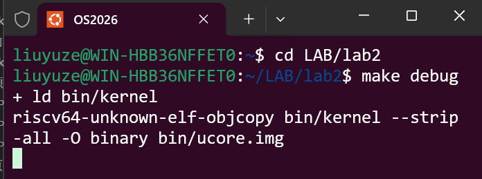
**终端2：添加宿主机gdb并设置断点**
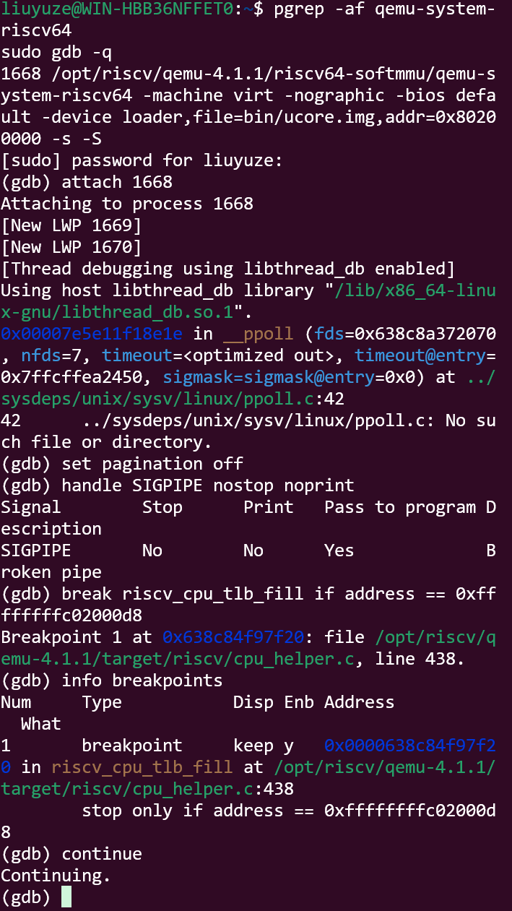
其中，条件断点 break riscv_cpu_tlb_fill if address == 0xffffffffc02000d8 确保只在 QEMU 翻译 kern_init 虚拟地址时暂停

##### 4. 进入内核物理入口
首先，进入gdb后设置断点：
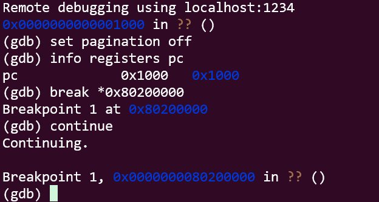
命中后执行：
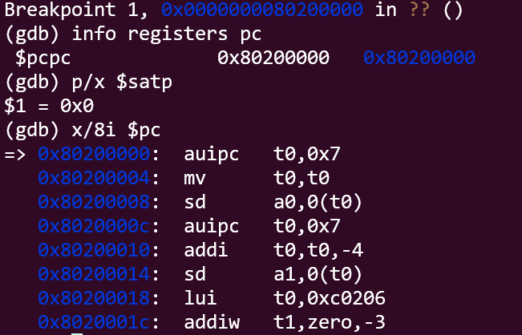
可知：
>kern_entry 的符号地址是高虚拟地址，但初始执行仍从物理地址 0x80200000 开始；页表内容虽然已在镜像中，但 satp = 0，分页尚未生效。

##### 5. 开启 Sv39 分页
使用`riscv64-unknown-elf-objdump -d bin/kernel | sed -n '/<kern_entry>:/,+35p'`,查看反汇编，得到：
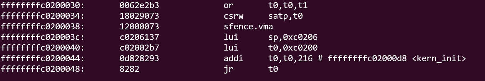
减去`PHYSICAL_MEMORY_OFFSET = 0xFFFFFFFF40000000`得到对应的物理地址：
```asm
0x80200034   csrw satp, t0
0x80200038   sfence.vma
0x8020003c   lui  sp, 0xc0206
0x80200040   lui  t0, 0xc0200
0x80200044   addi t0, t0, 216
0x80200048   jr   t0
```
所以，在 RISC-V GDB 终端执行：

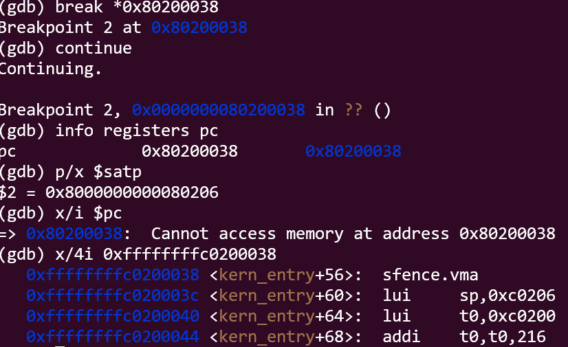

satp 已经从 0 变为有效的 Sv39 配置，说明分页模式已经开启；x/i $pc 失败是因为分页开启后 GDB 将物理地址解释为虚拟地址，而启动页表只映射高虚拟地址空间。

##### 6. 从内核入口切换到 kern_init

在 RISC-V GDB 设置断点后continue：
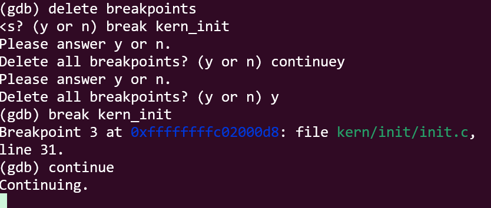
此后 RISC-V GDB 保持运行，客户机开始从物理入口继续执行，经过：
```txt
sfence.vma
设置内核栈
跳转到 kern_init 的高虚拟地址
```
此时切换到终端 2 的宿主机 GDB 查看条件断点是否命中:
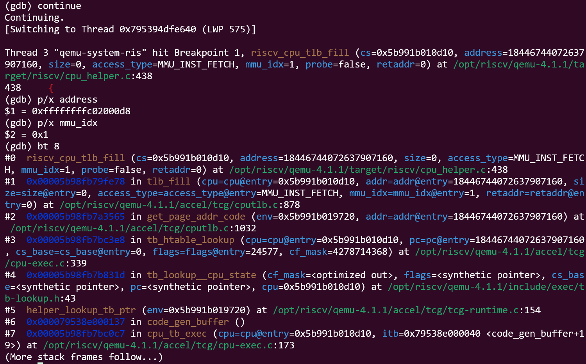
ucore 已经跳转到高虚拟地址 kern_init。QEMU 为了建立该地址对应的翻译块，需要先取得物理页地址；指令 TLB 未命中，于是沿 get_page_addr_code -> tlb_fill -> riscv_cpu_tlb_fill 进入 RISC-V 页表翻译流程。当前断点停在真正遍历页表之前。

##### 7. 进入页表翻译函数

在宿主机 GDB 中对 `get_physical_address()` 设置断点并继续执行。命中后可以看到：
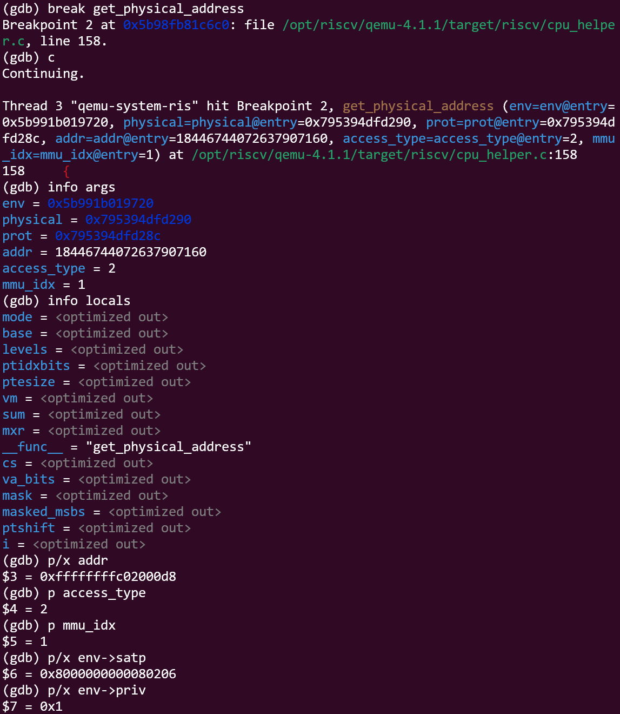

在 `get_physical_address()` 入口观察到待翻译虚拟地址为 `0xffffffffc02000d8`，访问类型为取指，`mmu_idx = 1`，对应当前 S 模式。`satp = 0x8000000000080206`，其中最高位模式字段为 8，根页表物理页号为 0x80206，根页表基址为 0x80206000。

函数入口处 `info locals` 显示部分变量为 `optimized out`，这是因为变量尚未完成初始化且 QEMU 构建带有优化。继续在页表循环内部设置断点后，可以观察 `base`、`pteshift`、`idx`、`pte_addr` 和 `pte`。对于 `kern_init` 所在的高虚拟地址，VPN2 为 0x1FF，预期根页表索引为 0x1FF，页表项地址为 0x80206FF8。该页表项为 1 GiB 叶子页表项，因此地址翻译可以在根页表阶段完成，最终得到物理地址 0x802000D8。

##### 8. 读取根页表项
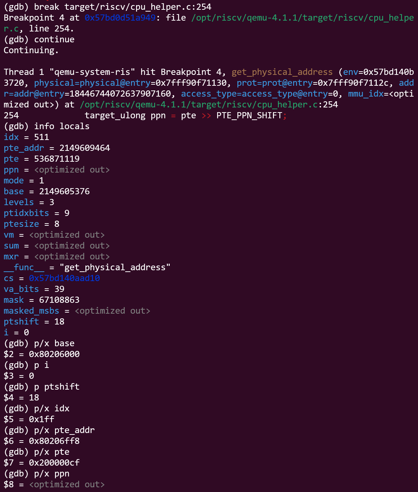
在根页表项读取完成后，GDB 显示：

- 根页表基址 `base = 0x80206000`；
- Sv39 的 `levels = 3`、`ptidxbits = 9`、`ptesize = 8`；
- 当前循环编号 `i = 0`；
- 根页表索引 `idx = 0x1FF`；
- 页表项地址 `pte_addr = 0x80206FF8`；
- 页表项值 `pte = 0x200000CF`。

PTE 的低位标志为 `0xCF`，其中有效位、读写执行权限位和 Accessed/Dirty 位均已设置，说明这是一个叶子页表项。由于 `i = 0` 时已经得到叶子项，本次转换无需继续遍历 VPN1 和 VPN0。根据 PTE 中的 PPN 计算得到 `ppn = 0x80000`，结合低 VPN 位和页内偏移，预期物理地址为 `0x802000D8`。

##### 9. TLB 页面写入

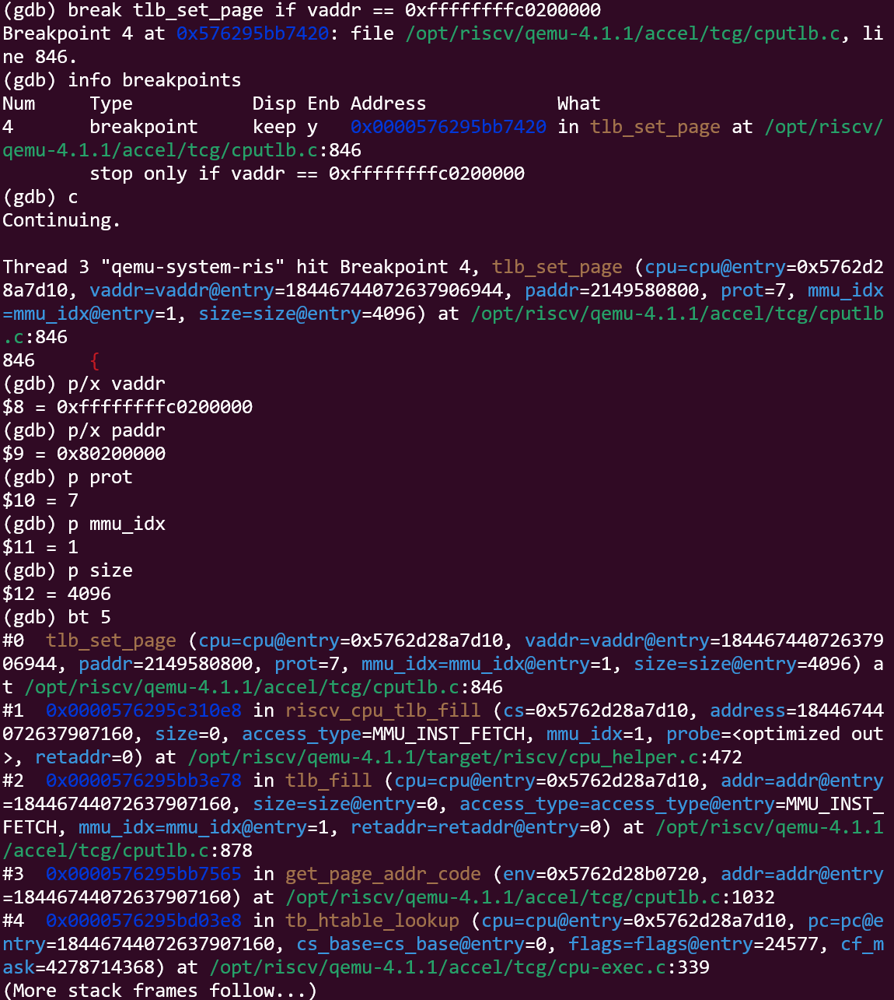

在 `tlb_set_page` 上设置页对齐地址条件断点后，宿主机 GDB 命中以下参数：

- `vaddr = 0xffffffffc0200000`
- `paddr = 0x80200000`
- `prot = 7`
- `mmu_idx = 1`
- `size = 4096`

`vaddr` 是 `kern_init` 虚拟地址去掉低 12 位偏移后的虚拟页基址；`paddr` 是对应的物理页基址。完整物理地址为：

`0x80200000 + 0x0d8 = 0x802000d8`

`prot = 7` 表示页面具有读、写、执行权限；`mmu_idx = 1` 对应 S 模式；`size = 4096` 表示当前 TLB 条目对应一个 4 KiB 页面。

调用栈从 `tb_htable_lookup()`、`get_page_addr_code()`、`tlb_fill()` 到 `riscv_cpu_tlb_fill()`，说明 QEMU 在指令 TLB miss 后完成了页表查询，并正在调用 `tlb_set_page()` 建立虚拟页到物理页的映射。

##### 10. 构造并写入软件 TLB 条目
等待目标 S 模式 TLB 写入:
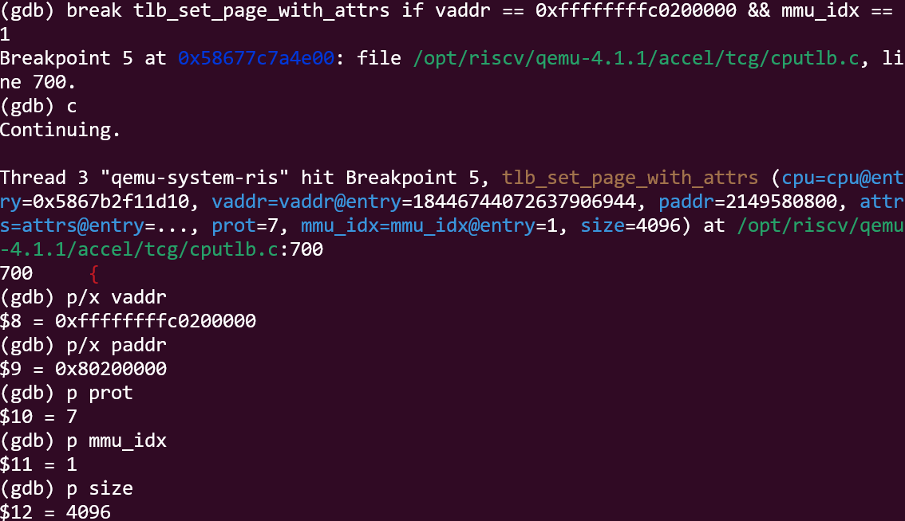
设置 TLB 字段写入后的断点:
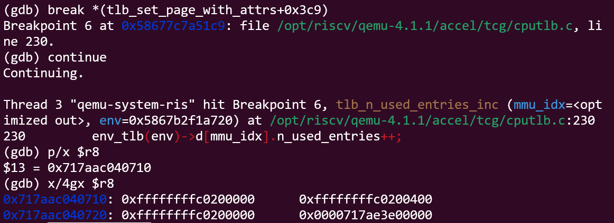

在 `tlb_set_page_with_attrs()` 入口，GDB 显示：

- `vaddr = 0xffffffffc0200000`
- `paddr = 0x80200000`
- `prot = 7`
- `mmu_idx = 1`
- `size = 4096`

这说明 QEMU 正在为 `kern_init` 所在的 S 模式虚拟页建立 4 KiB TLB 条目，物理页基址为 `0x80200000`，权限包含读、写和执行。

由于 QEMU 使用优化构建，直接在第 835 行设置断点会命中内联辅助函数；因此使用 `tlb_set_page_with_attrs + 0x3c9` 的函数偏移断点，在四个 TLB 字段写入之后暂停。

通过 `x/4gx $r8` 读取 `CPUTLBEntry`：

- `addr_read = 0xffffffffc0200000`
- `addr_write = 0xffffffffc0200400`
- `addr_code = 0xffffffffc0200000`
- `addend = 0x0000717ae3e00000`

`addr_read` 和 `addr_code` 均对应 `kern_init` 所在虚拟页；`addr_write` 中的 `0x400` 是 QEMU 的 `TLB_NOTDIRTY` 标志，不是物理地址的一部分；`addend` 是主机侧内存映射偏移，不是客户机物理地址。

这一结果证明 QEMU 已完成 Sv39 地址转换，并将虚拟页到宿主内存的映射写入软件 TLB。客户机物理页基址为 `0x80200000`，而实际物理访问还需要叠加页内偏移 `0x0d8`，因此完整物理地址为 `0x802000d8`。

##### 11. 验证tlb命中

设置同一虚拟地址的 TLB miss 观察断点:
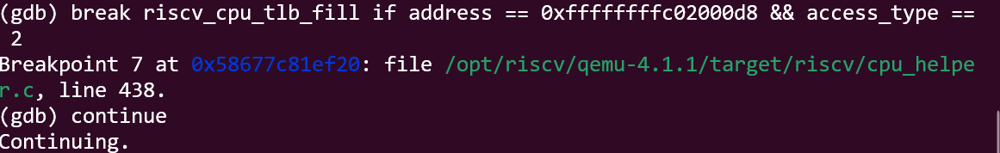
确认客户机 PC 已到达 kern_init
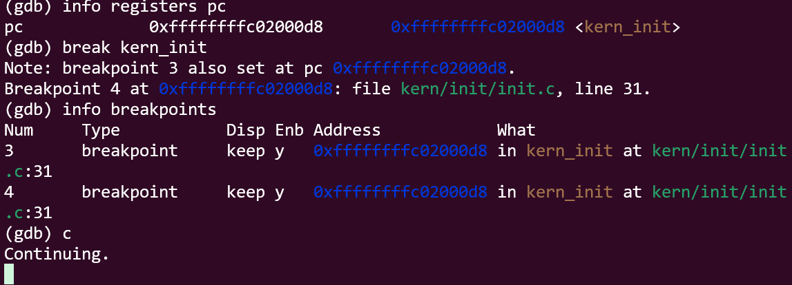

在宿主机 GDB 中设置条件断点,继续运行后，该断点没有再次命中，说明同一地址的后续取指没有重新进入 TLB miss 处理路径。

在 RISC-V GDB 中检查 PC，得到：`0xffffffffc02000d8 <kern_init>`说明客户机已经执行到高虚拟地址 `kern_init`。结合之前的 TLB 条目写入结果，可以确认该虚拟页在首次 miss 和页表翻译后已经建立软件 TLB 映射，后续访问直接命中 TLB，不再重复遍历页表。

#### QEMU 软件 TLB 与真实 CPU TLB 的对比

QEMU 4.1.1 中的 TLB 是 TCG softmmu 使用的软件缓存，而不是真实 RISC-V CPU 内部的硬件 TLB。相关实现可以直接从源码中观察：

- `include/exec/cpu-defs.h`：`CPUTLBEntry` 包含 `addr_read`、`addr_write`、`addr_code` 和 `addend` 四个字段。
- `accel/tcg/cputlb.c` 的 `tlb_fill()`：通用软件 TLB 的未命中入口，调用具体架构的 `tlb_fill` 回调。
- `target/riscv/cpu_helper.c` 的 `riscv_cpu_tlb_fill()`：RISC-V 架构的 TLB 填充实现。
- `target/riscv/cpu_helper.c` 的 `get_physical_address()`：根据 `satp` 和页表逐级查找 PTE，得到物理页地址和权限。
- `accel/tcg/cputlb.c` 的 `tlb_set_page_with_attrs()`：使用转换结果构造新的 `CPUTLBEntry`，并通过 `copy_tlb_helper_locked()` 写入软件 TLB。

本实验实际观察到的目标地址和 TLB 条目为：

```text
vaddr      = 0xffffffffc0200000
paddr      = 0x80200000
prot       = 7
mmu_idx    = 1
size       = 4096

addr_read  = 0xffffffffc0200000
addr_write = 0xffffffffc0200400
addr_code  = 0xffffffffc0200000
addend     = 0x0000717ae3e00000
```

`addr_read` 和 `addr_code` 对应目标虚拟页；`addr_write` 中的 `0x400` 是 QEMU 的 `TLB_NOTDIRTY` 标志；`addend` 是 QEMU 主机侧内存映射偏移，不是客户机物理地址。该值在一次运行中是固定的，但不同 QEMU 进程中可能变化。

| 对比项 | QEMU 软件 TLB | 真实 RISC-V CPU TLB |
|---|---|---|
| 实现形式 | C 语言维护的 `CPUTLBEntry` 数组 | CPU 内部的硬件缓存 |
| TLB 命中 | `tlb_hit()` 比较软件条目，命中后不调用 `tlb_fill()` | 硬件比较 VPN、ASID 和权限 |
| TLB miss | 进入 `tlb_fill()` 和 `riscv_cpu_tlb_fill()` | 硬件 MMU 触发页表遍历 |
| 页表遍历 | QEMU 执行 `get_physical_address()` | 硬件 page-table walker 自动完成 |
| 条目写回 | `tlb_set_page_with_attrs()` 写入软件表项 | 硬件自动填充 TLB |
| 保存内容 | 虚拟页标签、访问权限和主机侧 `addend` | VPN 到 PPN 的映射、权限、ASID 等 |
| 可观察性 | 可以用 GDB 查看函数、变量和条目内容 | 通常不能由操作系统直接查看 |
| Bare 模式 | `get_physical_address()` 直接返回原地址 | 不进行页表和 TLB 转换 |

因此，QEMU 的软件 TLB 是可被 GDB 观察和单步分析的模拟结构，而真实 CPU 的 TLB 是透明的微架构硬件。QEMU 为了把客户机物理内存映射到模拟器进程的宿主内存，在软件 TLB 中保存 `addend`；真实 CPU 的 TLB 则直接保存客户机虚拟页到物理页帧的转换结果。

#### 调试过程中的问题和处理

1. **`kern_entry` 虚拟地址断点不命中**

`kern_entry` 的链接地址为 `0xffffffffc0200000`，但 OpenSBI 首次进入内核时仍从物理地址 `0x80200000` 取指。此时 `satp = 0`，分页尚未生效，因此高虚拟地址断点不会命中。通过 `break *0x80200000` 可以正确停在物理入口。

2. **`satp` 开启后旧低地址断点无法重新插入**

分页开启后，`0x80200000` 等低物理地址没有对应的 Sv39 虚拟映射。GDB 继续运行时尝试重新插入旧的软件断点，出现 `Cannot access memory`。处理方法是删除低地址断点，改用高虚拟地址 `break kern_init`。

3. **分页开启后 `x/i $pc` 读取失败**

CPU 仍停在物理地址 `0x80200038`，但 GDB 在分页开启后按虚拟地址解释该值，因而无法读取。通过高虚拟别名 `x/i 0xffffffffc0200038` 可以查看同一条指令。

4. **条件断点最初命中 M 模式数据写**

只按 `vaddr` 过滤时，曾命中 `address = 0xffffffffc0200f50`、`access_type = MMU_DATA_STORE`、`mmu_idx = 3` 的访问。M 模式进行恒等转换，因此 `paddr` 与 `vaddr` 相同，这不是目标 Sv39 翻译。增加 `mmu_idx == 1` 和 `access_type == MMU_INST_FETCH` 条件后，才准确捕获 `kern_init` 的 S 模式取指。


####  使用 AI 辅助调试的经验

本次调试中，AI 主要用于帮助定位 QEMU 源码中的关键路径、解释虚拟地址和物理地址断点的差异、分析优化构建下源码行断点失效的原因，以及根据反汇编给出稳定的函数偏移断点。


## 五、测试与验证

<!-- 根据该实验的具体情况，提供完整的测试运行截图，应包含：
- 编译及运行成功的输出（make qemu），可能有多个
- 测试通过的结果（make grade），只有一个
-->
### 1. page_init与Best-Fit
首先把当前管理器切换为 Best-Fit

```python
pmm_manager = &best_fit_pmm_manager;
```
之后分别`make qemu`、`make grade`
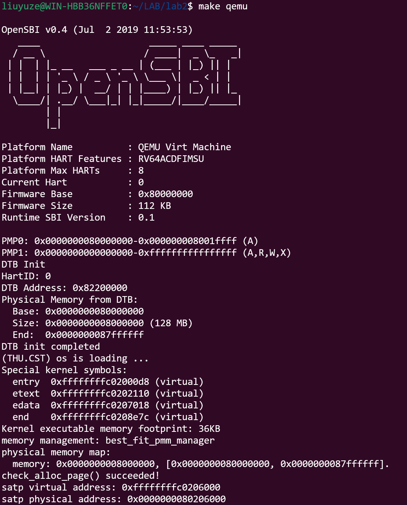
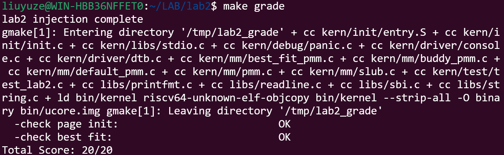

### 2. Buddy 与 SLUB

当前管理器切回 Buddy

```python
pmm_manager = &buddy_pmm_manager;
```
然后`make qemu`:
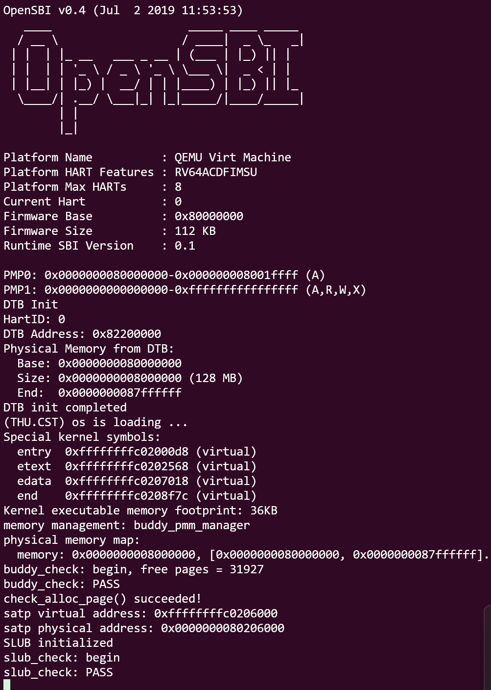 


---

## 六、实验总结与收获

### 对操作系统的理解

#### 本实验中的重要知识点及其与 OS 原理的对应关系

- **启动与内存发现**：实验通过 OpenSBI 和 DTB 获取物理内存范围，对应 OS 启动阶段的固件交接和硬件资源探测；区别是实验直接依赖 RISC-V 设备树和 QEMU 平台。
- **Page 描述符与物理页管理**：实验用连续 `Page` 描述符和 `free_list` 管理物理页，对应 OS 的页帧分配器；`property`、引用计数和保留页标志是实验中的具体实现。
- **First-Fit 与 Best-Fit**：实验比较两种连续空闲块分配策略，对应经典的动态分区分配思想；First-Fit 优先选择首个可用块，Best-Fit 选择最小可满足块，二者的碎片表现和搜索开销不同。
- **Buddy System**：实验按 2 的幂拆分和合并页块，对应 OS 的页级伙伴分配；通过 Buddy 对齐关系限制合并范围，兼顾分配速度和外部碎片。
- **SLUB 两层分配**：实验先由 Buddy 提供整页，再在页内按对象大小分类管理，对应 OS 的 slab/SLUB 对象缓存；页级分配解决物理页来源，对象层解决小对象复用。
- **Sv39 页表与 TLB**：实验观察 `satp`、三级页表、1 GiB 叶子页表项和 TLB miss/hit，对应 OS 的虚拟内存、地址翻译和快表机制；QEMU 的软件 TLB 可用 GDB 观察，而真实 CPU TLB 是硬件实现。
- **分页前后地址语义**：`kern_entry` 初始从物理地址执行，设置 `satp` 后跳转到高虚拟地址 `kern_init`；这体现了启动代码、链接地址、页表映射和取指路径之间的关系。
- **双重 GDB 调试**：宿主机 GDB 观察 QEMU，RISC-V GDB 观察 ucore，对应“模拟器层”和“客户机系统层”的交叉调试方法。

#### OS 原理中重要但本实验未覆盖或只做了简化的知识点

- 需求分页、页面置换、交换空间和工作集管理：本实验只建立页表映射，没有实现运行时缺页和换页。
- 多进程地址空间、ASID 和跨核 TLB shootdown：实验主要观察内核启动映射和单个软件 TLB。
- 用户态与内核态的完整保护机制：实验涉及 S 模式和页表权限，但没有覆盖完整的用户态隔离、系统调用和异常处理。
- NUMA、内存热插拔、内存压缩和复杂碎片整理：实验的物理内存范围和分配器规模都较固定、简化。
- 多核并发下的锁竞争、每 CPU 缓存和无锁分配：本实验主要是单核启动路径，未深入并发性能与一致性问题。

### AI 协作开发的经验

- **先写规格，再让 AI 写代码**：说明目标、可信上下文、函数签名、正常路径和异常路径，生成结果比只给函数名的提示词更可靠。
- **上下文必须来自真实代码**：宏、结构体、函数签名和地址关系应从工程中复制，不能凭记忆编写，否则容易出现类型不匹配或边界错误。
- **必须保留测试证据**：编译成功不等于功能正确，应结合 `make grade`、QEMU 输出和断言结果检查分配、释放、合并和页表状态。
- **边界条件要单独验证**：例如不完整尾页、无可用空闲页、非 2 的幂请求、页表项无效和 TLB 命中/未命中，都是容易遗漏的关键场景。
- **AI 建议需要验证**：调试中曾遇到物理地址断点、优化构建行号偏移和 M 模式恒等映射误判；应通过 QEMU 源码、反汇编和 GDB 实际输出核对 AI 的解释。
- **调试记录要保留现象和根因**：记录原始命令、关键寄存器、调用栈和修改前后差异，才能区分代码错误、调试环境问题和观察方式问题。

---

