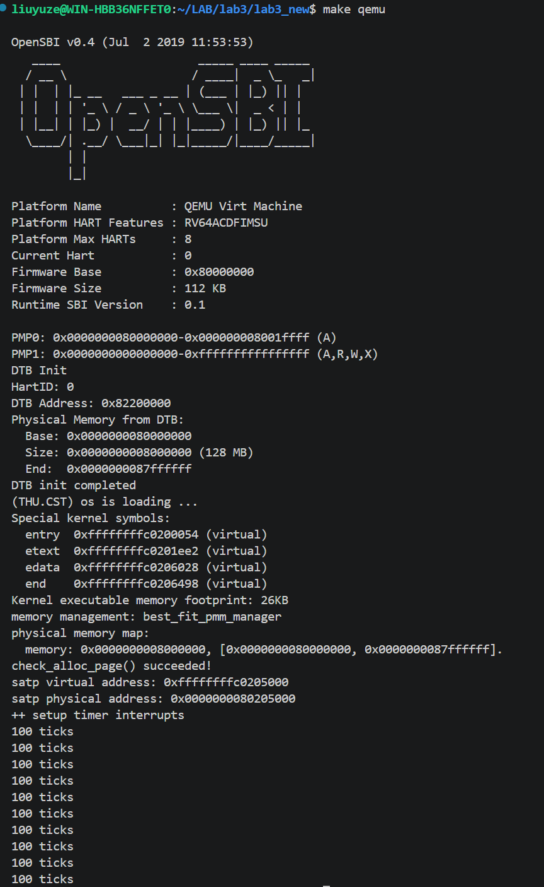
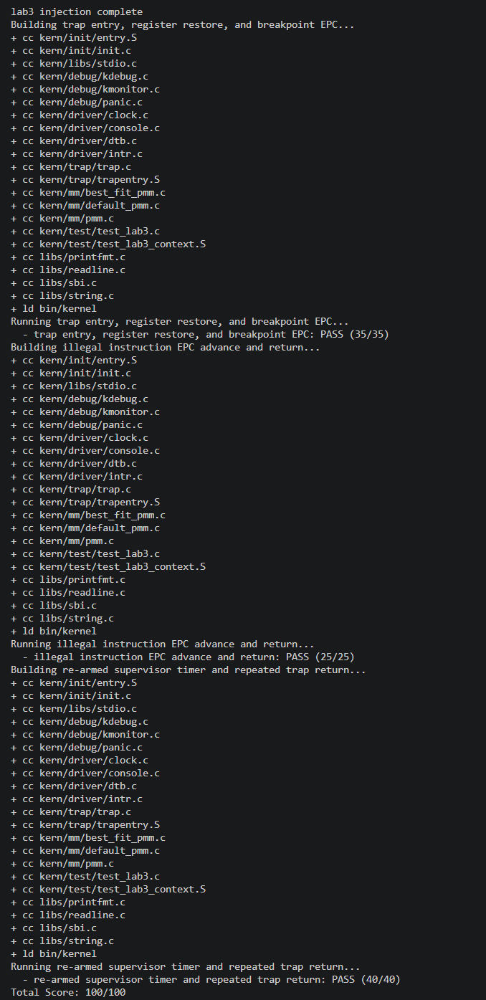

# 操作系统实验报告

## 实验基本信息

| 项目 | 内容 |
|------|------|
| **实验名称** | Lab 3: 断，都可以断 |
| **小组成员** | 2411334-刘宇泽、2410818-李子熹、2411951-赵雨涵 |
| **完成日期** | 2026.11.3 |

### 小组分工


| 成员 | 负责的练习/模块 |
|------|----------------|
| 2411334-刘宇泽 | 功能模块一`RESTORE_ALL` |
| 2410818-李子熹 | 功能模块一`__alltraps`|
| 2411951-赵雨涵 | 功能模块二 |


---

## 一、实验目的

<!-- 说明本次实验的主要目标和预期成果 -->

本实验的主要目的是：

实验3主要讲解的是中断处理机制。操作系统是计算机系统的监管者，必须能对计算机系统状态的突发变化做出反应，这些系统状态可能是程序执⾏出现异常，或者是突发的外设请求。当计算机系统遇到突发情况时，不得不停⽌当前的正常⼯作，应急响应⼀下，这是需要操作系统来接管，并跳转到对应处理函数进⾏处理，处理结束后再回到原来的地⽅继续执⾏指令，这个过程就是中断处理过程。

---

## 二、实验环境

| 成员 | AI 编程工具 | 底层模型 | 备注 |
|------|------------|---------|------|
| 2411334-刘宇泽 | codex cli | gpt 6| 无 | 
| 2410818-李子熹 | codex cli | gpt 6| 无 | 
| 2411951-赵雨涵 | codex cli | gpt 6| 无 | 

---

## 三、实验整体逻辑分析

### 2.1 本章节的逻辑主线

- **核心主题**：补齐 RISC-V S 模式的 Trap 处理链路，实现“保存现场、进入 C 处理函数、识别并处理事件、恢复现场、返回原执行流”的闭环。
- **解决的问题**：如何保存和恢复寄存器现场；汇编入口如何把 `trapframe` 传给 `trap()`；如何区分中断与异常；异常返回前如何修正 `sepc`；时钟中断如何持续重新装载。

整体按“建立现场 → 接通入口 → 分类处理 → 恢复返回 → 时钟验证”的顺序实现。

### 2.2 功能的逐步实现

1. **保存现场**：`SAVE_ALL` 在内核栈上构造 `trapframe`，保存通用寄存器和关键 CSR。
2. **恢复现场**：`RESTORE_ALL` 恢复 CSR 和通用寄存器，`sp` 最后恢复。
3. **接通入口**：`__alltraps` 把 `sp` 作为参数传入 `a0`，调用 `trap()`，返回后执行 `RESTORE_ALL` 和 `sret`。
4. **分类分发**：`trap_dispatch()` 根据 `tf->cause` 最高位区分中断和异常。
5. **异常处理**：断点和非法指令输出信息并推进 `tf->epc`；其他异常调用 `print_trapframe(tf)`。
6. **中断处理**：时钟中断更新 `ticks` 并重设下一次事件；其他中断分类提示，未知情况打印 trapframe。
7. **初始化**：`idt_init()` 设置 `stvec`，`clock_init()` 启动第一次时钟事件，`intr_enable()` 打开 S 模式中断。
8. **验证**：分别验证上下文恢复、非法指令返回和时钟持续触发。

---

## 四、实验内容与实现

<!-- 
说明：本部分按照 exercises 文档中的练习顺序组织
每个功能模块或者练习中可能包含多项任务，请根据实际情况调整
-->

### 功能模块一：Trap 上下文恢复与 Trap 入口功能

**负责人：** 2410818-李子熹 2411334-刘宇泽

##### 模块功能描述

**需要实现/修改的函数：**

```c
.macro RESTORE_ALL
    ...
.endm

.globl __alltraps
__alltraps:
    SAVE_ALL
    ...
```

**功能说明：**

- **该模块在整个系统中的作用**：位于硬件 Trap 入口与 C 语言处理逻辑之间，负责保存和恢复被打断执行流的完整上下文。它与已有的 `SAVE_ALL` 配合，形成“Trap 进入、保存现场、调用处理函数、恢复现场、返回原执行流”的闭环，是后续中断和异常处理能够正确运行的基础。

- **需要处理的主要场景**：任意 Trap 发生时进入统一入口；C 处理函数返回后恢复通用寄存器和 `sstatus`、`sepc` 等 CSR；异常处理修改 `tf->epc` 后，通过恢复 `sepc` 让 `sret` 返回正确位置；恢复 `sp` 时保证内核栈回到 Trap 发生前的状态。

- **与其他模块的交互关系**：`idt_init()` 将 `stvec` 指向 `__alltraps`，硬件随后进入本模块；`SAVE_ALL` 构造 `trapframe`，`__alltraps` 将其地址作为参数传给 `trap()`；`trap_dispatch()` 和具体处理函数可能修改 `tf->epc` 等字段；处理完成后回到 `__trapret`，由 `RESTORE_ALL` 恢复现场并执行 `sret`。

##### 最终提示词

以下是经过迭代优化后，最终成功实现该功能的提示词：

*`RESTORE_ALL`*
````markdown
[PROMPT]
**任务**：修改 `kern/trap/trapentry.S` 的 `RESTORE_ALL`，从当前 trapframe 恢复 Trap 返回前的 CPU 状态；只改宏体，不改 `SAVE_ALL`、trapframe 布局、`trap()` 签名和 `__trapret/sret`。

**操作要求**：直接修改真实文件，只补 `RESTORE_ALL`；临时寄存器只在宏内使用。

**输出要求**：严格按下面布局实现，不引入无关功能。

[RELY]
// RV64: LOAD=ld, STORE=sd, REGBYTES=8
// trapframe 偏移：0 zero, 1 ra, 2 sp, 3 gp, 4 tp,
// 5-7 t0-t2, 8-9 s0-s1, 10-17 a0-a7,
// 18-27 s2-s11, 28-31 t3-t6,
// 32 status, 33 epc, 34 badvaddr, 35 cause
// SAVE_ALL 将原 sp 存到偏移 2；sret 使用 sepc/sstatus。
// trap() 可能修改 tf->epc。

[GUARANTEE]
```asm
.macro RESTORE_ALL
    ...
.endm
```

[SPECIFICATION]
**Pre-Condition**：`sp` 指向 `SAVE_ALL` 建立的 36 字 trapframe。

**Post-Condition**：除 `x0` 外通用寄存器全部恢复；`sstatus`、`sepc`、`sbadaddr`、`scause` 从偏移 32-35 回写；`sp` 恢复为偏移 2 的值；trapframe 不被改写。

**Cases**：
- 正常返回：恢复后 `sret` 回到原执行流。
- `tf->epc` 被修改：恢复后的 `sepc` 必须使用新值。
- 恢复 `sp` 前完成所有基于 `sp` 的加载，之后不再使用旧基址。

**Requirements**：与 `SAVE_ALL` 偏移严格对应；`x0` 保持 0；CSR 在 `sret` 前恢复。
````
*`__alltraps`*
````markdown
[PROMPT]
**任务**：修改 `kern/trap/trapentry.S` 的 `__alltraps`，在 `SAVE_ALL` 后把 trapframe 传给 `trap()`，返回后进入 `__trapret`。

**操作要求**：只改 `SAVE_ALL` 后的调用部分，不改 `SAVE_ALL`、`RESTORE_ALL`、`__trapret` 和 `sret`。

**输出要求**：直接修改文件，遵循 RISC-V 调用约定。

[RELY]
void trap(struct trapframe *tf);
// SAVE_ALL 后 sp 指向 trapframe；a0 是第一个参数；
// ra 已保存在偏移 1；__trapret 紧跟其后。

[GUARANTEE]
```asm
.globl __alltraps
__alltraps:
    SAVE_ALL
    ...
```

[SPECIFICATION]
**Pre-Condition**：通过 `stvec` 进入，`SAVE_ALL` 已完成，`sp` 指向完整 trapframe。

**Post-Condition**：以 `sp` 作为第一个参数调用 `trap()`；返回后 `sp` 不变并进入 `__trapret`；trapframe 不被修改。

**Cases**：
- 正常返回：`trap()` 收到有效 trapframe，处理后继续 `RESTORE_ALL`。
- `tf->epc` 被修改：返回后仍指向原 trapframe，后续恢复读取新值。

**Requirements**：第一个参数用 `a0`；调用前后保持 trapframe 地址不变；入口四字节对齐。

````

##### 实现迭代过程

本模块的提示词和实现主要经历了 1 次迭代。

---

###### 第一次迭代

**初始提示词与问题：**

- 初始提示词只写了“实现 `RESTORE_ALL` 和 `__alltraps`”，没有给出 trapframe 的真实偏移和 `SAVE_ALL` 的保存关系，容易把通用寄存器按错误顺序恢复。
- 没有强调 `sp` 的特殊性，可能把 `sp` 和普通通用寄存器一样提前恢复，导致后续基于 `sp` 的加载访问错误地址。
- 没有明确 `sepc`、`sstatus` 必须从 trapframe 回写 CSR，可能导致异常处理中修改的 `tf->epc` 不生效。
- 没有明确 `__alltraps` 的调用约定，容易忘记把 trapframe 地址放入 `a0`，或者在调用 `trap()` 后跳过 `__trapret`。

**修改内容：**

- 将提示词补充为四段式，加入 `struct trapframe` 的字段顺序、偏移关系以及 `SAVE_ALL` 的实际保存行为。
- 明确 `RESTORE_ALL` 先恢复 CSR，再恢复通用寄存器，`x0` 不恢复，`sp` 必须最后恢复。
- 明确 `__alltraps` 使用 `mv a0, sp` 传递 trapframe 地址，并通过 `jal trap` 调用 C 处理函数，返回后继续进入 `__trapret`。
- 限定修改范围，只补全两个标记位置，不改变 `SAVE_ALL`、trapframe 布局和 `trap()` 的函数签名。

**最终结果：**

- 完成了 `RESTORE_ALL` 和 `__alltraps`，使内核具备完整的 Trap 上下文管理能力。
- `RESTORE_ALL` 按 trapframe 布局恢复 `sstatus`、`sepc`、`sbadaddr`、`scause` 和通用寄存器，并最后恢复 `sp`，保证 `sret` 能回到原执行流。
- `__alltraps` 将 trapframe 地址放入 `a0` 调用 `trap()`，返回后继续进入 `__trapret`，形成“保存现场、调用处理函数、恢复现场、返回”的闭环。

**关键改进点总结：**

1. 将模糊的函数名需求改为可验证的上下文恢复规格，明确 trapframe 布局、CSR 回写和返回路径。
2. 明确 `sp` 的特殊处理和 `__alltraps` 的调用约定，减少上下文保存与恢复不一致的问题。


---

### 功能模块二：中断与异常处理功能

**负责人：** 2411951-赵雨涵 


##### 模块功能描述

**需要实现/修改的函数：**

```c
void interrupt_handler(struct trapframe *tf);
void exception_handler(struct trapframe *tf);
```

**功能说明：**

- **该模块在整个系统中的作用**：负责 Trap 进入 C 语言层后的具体分类处理，是 `trap_dispatch()` 的下游模块。它根据 `tf->cause` 判断中断或异常类型，执行时钟计数、异常返回地址修正和兜底打印，处理完成后返回统一的 Trap 返回路径。

- **需要处理的主要场景**：S 模式时钟中断的持续触发；软件中断和外部中断的基本提示；未知中断的兜底输出；断点异常和非法指令异常的信息输出及 `tf->epc` 修正；其他未知异常的 `print_trapframe(tf)` 兜底。

- **与其他模块的交互关系**：`__alltraps` 把 trapframe 传给 `trap()`，`trap_dispatch()` 再调用本模块；时钟中断调用 `clock_set_next_event()` 重新装载下一次事件，并通过 `ticks` 记录节拍；异常处理修改 `tf->epc` 后，由 `RESTORE_ALL` 恢复 `sepc`，最终通过 `sret` 返回。

##### 最终提示词

以下是经过迭代优化后，最终成功实现该功能的提示词：

````markdown
[PROMPT]
**任务**：修改 `kern/trap/trap.c`，实现 `interrupt_handler()` 和 `exception_handler()`，处理时钟中断、其他中断、断点、非法指令和未知异常。

**操作要求**：只补两个函数，不改已有函数签名；可增加 `static` 辅助函数和内部宏；使用 `sbi_shutdown()` 时包含 `<sbi.h>`。

**输出要求**：直接修改文件，处理结果必须能被 `tools/grade.sh` 识别。

[RELY]
#define TICK_NUM 100
#define IRQ_S_SOFT 1
#define IRQ_S_TIMER 5
#define IRQ_S_EXT 9
#define CAUSE_ILLEGAL_INSTRUCTION 0x2
#define CAUSE_BREAKPOINT 0x3

extern volatile size_t ticks;
void clock_set_next_event(void);
void sbi_shutdown(void);
void print_trapframe(struct trapframe *tf);

static void print_ticks(void);
// cause 最高位 1 为中断，否则为异常；中断号需去掉最高位。
// epc 是异常指令或被打断指令的地址。

[GUARANTEE]
```c
void interrupt_handler(struct trapframe *tf);
void exception_handler(struct trapframe *tf);
```

[SPECIFICATION]
## interrupt_handler

**Pre-Condition**：`tf` 有效，`tf->cause` 最高位为 1。

**Post-Condition**：时钟中断更新 `ticks` 并重设定时器；其他中断只输出提示；返回统一 Trap 路径。

**Cases**：
- `IRQ_S_TIMER`：`ticks++`，调用 `clock_set_next_event()`；每 `TICK_NUM` 次调用 `print_ticks()`；达到关机阈值后 `sbi_shutdown()`。
- `IRQ_S_SOFT`：输出 `Supervisor software interrupt`。
- `IRQ_S_EXT`：输出 `Supervisor external interrupt`。
- 其他：输出去掉最高位的原因码 `Unknown interrupt: cause N`，并调用 `print_trapframe(tf)`。

**Requirements**：每次时钟中断都重装；不重置 `ticks`；关机阈值对应 tick 数大于 `2 * TICK_NUM`，建议取 10 次统计输出。

## exception_handler

**Pre-Condition**：`tf` 有效，`tf->cause` 最高位为 0。

**Post-Condition**：非法指令和断点推进 `tf->epc`；其他异常只打印现场；不改 `tf->cause`。

**Cases**：
- `CAUSE_ILLEGAL_INSTRUCTION`：输出 `Illegal instruction at <地址>`，按指令长度推进 `tf->epc`。
- `CAUSE_BREAKPOINT`：输出 `Breakpoint at <地址>`，按指令长度推进 `tf->epc`。
- 其他：调用 `print_trapframe(tf)`，不修改 `tf->epc`。

**Requirements**：指令低两位为 `11` 时加 4，否则加 2；原因码 20 输出 `cause    0x00000014`；不直接执行 `sret`。

**验收输出**：`Breakpoint at`、`Illegal instruction at`、`Supervisor software interrupt`、`Unknown interrupt: cause 15`、`cause    0x00000014`、`100 ticks`、`ticks=200`。
````

##### 实现迭代过程

本模块的提示词和实现主要经历了 1 次迭代。

---


**最终结果：**

- 完成了 `interrupt_handler()` 和 `exception_handler()`，使内核能够区分并处理时钟中断、软件中断、外部中断、断点异常、非法指令异常和未知情况。
- 时钟中断每次更新 `ticks` 并调用 `clock_set_next_event()` 重装下一次事件，每 `TICK_NUM` 次输出一次 `100 ticks`；累计 10 次统计输出后调用 `sbi_shutdown()`。
- 断点和非法指令会根据指令长度推进 `tf->epc`，避免从异常指令处重复执行；未知中断和未知异常通过 `print_trapframe(tf)` 输出完整现场。
- `make grade` 第二组和第三组分别通过 `25/25`、`40/40`，三组总分 `100/100`。
- `make qemu` 能观察到时钟中断启动并连续输出 `100 ticks`，达到关机阈值后 QEMU 正常退出。

---

## 五、测试与验证

### make qemu


运行后内核完成 OpenSBI、设备树和物理内存初始化，启动时钟中断并连续输出 `100 ticks`。累计 10 次统计输出后调用 `sbi_shutdown()`，QEMU 正常退出，说明时钟中断能够持续触发并进入统一的 Trap 返回路径。

###  make grade


`make grade` 分别验证 Trap 上下文恢复与断点返回、非法指令与异常兜底、时钟中断持续触发。三组测试分别通过 `35/35`、`25/25`、`40/40`，总分为 `100/100`。


---

## 六、实验总结与收获

### 对操作系统的理解

#### 本实验中的重要知识点及其与 OS 原理的对应关系

- **Trap 与中断/异常分类**：RISC-V 用 `scause` 的最高位区分中断和异常，再用原因码区分时钟、软件中断、断点和非法指令。对应 OS 原理中的 Trap 机制：硬件负责发现事件并进入内核，软件负责识别事件类型并执行处理策略。
- **上下文保存与恢复**：`trapframe` 把通用寄存器和关键 CSR 组织成固定布局，`SAVE_ALL` 保存现场，`RESTORE_ALL` 恢复现场。对应 OS 原理中的中断现场保护和上下文切换，是内核能够“打断后继续执行”的基础。
- **特权级与 CSR**：`stvec` 决定 Trap 入口，`sstatus.SIE/SPIE/SPP` 控制中断使能和返回特权级，`sepc` 保存返回地址。对应 OS 原理中的内核态/用户态切换、中断屏蔽和特权级保护。
- **精确异常与返回地址**：断点和非法指令的 `sepc` 指向触发异常的指令，必须按 2 字节或 4 字节指令长度推进，否则会重复执行。对应 OS 原理中的精确异常和可重启指令语义。
- **时钟中断与时间片**：`clock_set_next_event()` 在每次时钟中断后重新设置下一次事件，`ticks` 记录节拍。对应 OS 原理中的定时器、时间片和抢占式调度的基础；本实验只实现了节拍，没有实现进程调度。
- **物理内存管理**：lab2 的 `page_init()` 和 Best-Fit 分配器负责建立空闲页链表。对应 OS 原理中的物理页分配、空闲块管理和内存资源回收。

#### OS 原理中重要但本实验未覆盖或只做了简化的知识点

- **进程/线程调度与真正的上下文切换**：本实验只累计时钟节拍，没有进程控制块、调度队列、时间片选择和进程切换。
- **用户态到内核态的完整转换**：本实验主要处理 S 模式 Trap，没有覆盖用户态 `ecall`、系统调用分发和 U/S 特权级切换。
- **缺页异常与虚拟内存管理**：没有实现缺页处理、按需分页、页面置换和地址空间隔离。
- **外设中断与并发控制**：没有深入处理中断控制器、外设中断、中断嵌套、多核并发、锁和优先级反转。
- **完整的异常恢复策略**：对未列出的异常主要使用 `print_trapframe()` 兜底，没有实现信号、异常修复或进程终止等完整策略。

### AI 协作开发的经验

- 提示词不能只写函数名，必须给出 trapframe 的真实偏移、`sp` 的特殊处理、CSR 回写关系和测试输出要求；这些约束比“实现某个函数”更能减少错误。
- 测试脚本是最好的行为规格。`grade.sh` 的检查项明确了 `Breakpoint at`、`Illegal instruction at`、`ticks=200` 等验收条件，编写提示词时应直接转化为可验证的规格。
- 修改范围要限定在标记位置，并保留 `SAVE_ALL`、trapframe 布局和测试文件。先生成局部实现，再通过单目标编译和反汇编检查，最后运行 `make grade`，比一次性改完再排查更有效。


---

